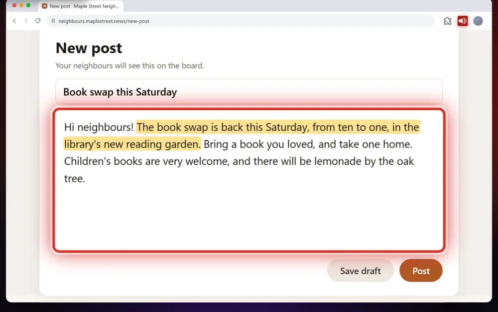

The TTSReader Chrome extension turns any website into voice. A long article and a full inbox compete for the same pair of eyes; we built the extension so the article reads itself aloud while your eyes stay on the work.

<!-- AMIEL: optional, one or two lines of your own here. Delete this comment when done. -->



*On your phone? Watch the [Short](https://youtube.com/shorts/g4I0Qn9MYDE).*

Say the local news has a long piece on the Maple Street library, which reopens on Saturday with a reading garden after a year of repairs, and your inbox is waiting. Add TTSReader to Chrome once and pin it to your toolbar, so its icon is always one click away. On the article, click the icon and press play on the player that appears, or right-click the page and choose **Play Page**. Each part lights up as it's read, and the page scrolls along with it.

Then go back to your inbox in another tab. The article keeps reading while you answer email, or work on a spreadsheet or a design. On a research day it reads you the sources while you take notes.

You don't have to take the whole page. Select one paragraph, the opening of the Gettysburg Address for a history class, and it reads only that paragraph. On a long blog post, press the hand button on the player, click the paragraph you want, and it starts from there. The speed, in the side panel, goes from 0.5× to 2×: an English learner can slow a fable down to three-quarter speed, and a long post can go at one and a half.

Later you write a post for the neighbourhood board: the book swap is back this Saturday, in the library's new reading garden. Before you press Post, press the same hand button, click the text box, and hear your own writing read back to you.

To start, sign in with Google or Apple in the side panel, and the Basic voices are free. With Premium, you get even more voices, like Adam Premium, who reads the library article in the video.

<a style="color:white;font-weight: bold" href="https://chromewebstore.google.com/detail/ttsreader-v3-premium-ai-t/kimpjeeihakmgdlnkjaapkdikpjccabi" target="_blank">👉 &nbsp; ADD TTSREADER TO CHROME</a>

 

No extension? [Open TTSReader in your browser](https://ttsreader.com/player/). More on listening to web pages in the [guide to reading web pages](https://ttsreader.com/docs/guides/read_webpages/), and the story of the extension in [our earlier post](https://ttsreader.com/blog/websites-reader-ttsreaderx-chrome-extension/). To install it, see the [TTSReader extension page](https://ttsreader.com/x/).


The TTSReader Chrome extension turns any website into voice. Listen to a long article while you work in another tab: your inbox, a spreadsheet, a design.

"The Maple Street library reopens on Saturday, with a reading garden, after a year of repairs."

Or take notes while it reads you the research. Add it to Chrome, and pin it to your toolbar. Click the TTSReader icon, and press play on the player that appears. Or right-click the page, and choose Play Page. Each part lights up as it's read, and the page scrolls along with it.

For a history class, select one paragraph of a speech, and it reads only that paragraph.

"Four score and seven years ago our fathers brought forth on this continent, a new nation, conceived in Liberty."

On a long blog post, press the hand button, click the paragraph you want, and it starts from there. Slow a fable down to three-quarter speed to learn English, or speed a long post up to one and a half. Press the same button, click a text box, and hear your own writing before you post it.

In the side panel, sign in with Google or Apple, and the Basic voices are free. With Premium, you get even more voices, like the one that read the article at the start. Add TTSReader to Chrome, and press play. ttsreader.com


*All speech in the video was produced with TTSReader: Nova Premium (the guide) and Adam Premium (the extension reading the page). The Gettysburg Address (Abraham Lincoln, 1863) and "The North Wind and the Sun" (Aesop's Fables, translated by George Fyler Townsend, 1867, [Project Gutenberg](https://www.gutenberg.org/ebooks/21)) are in the public domain. The news, class, fable and neighbourhood pages were written for the video; the sites are fictional.*
