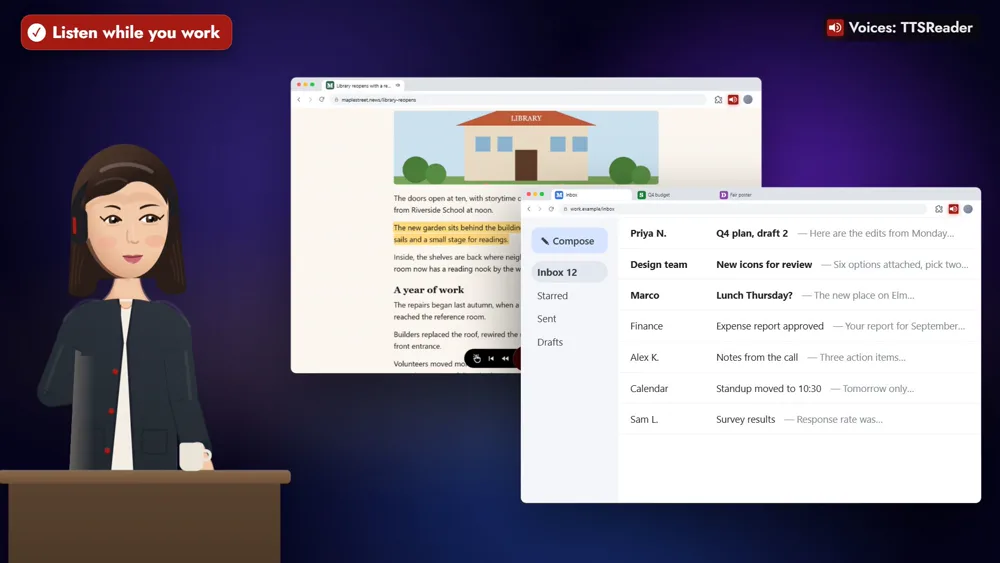
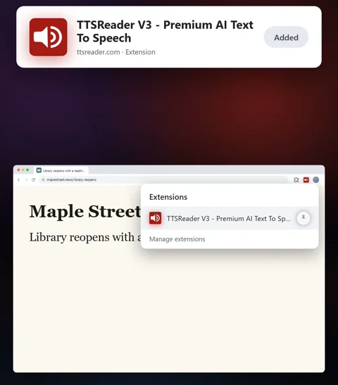
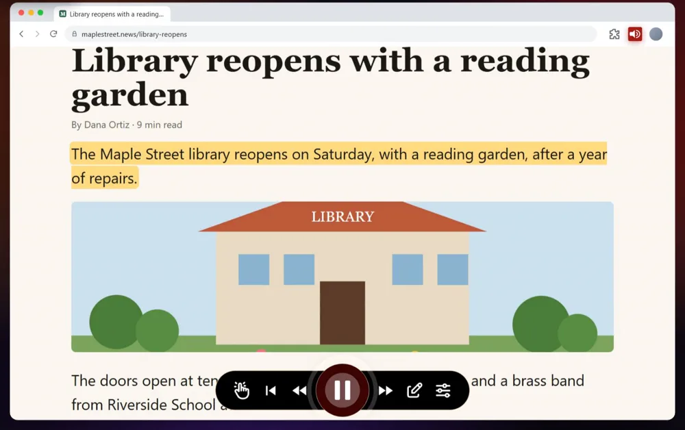
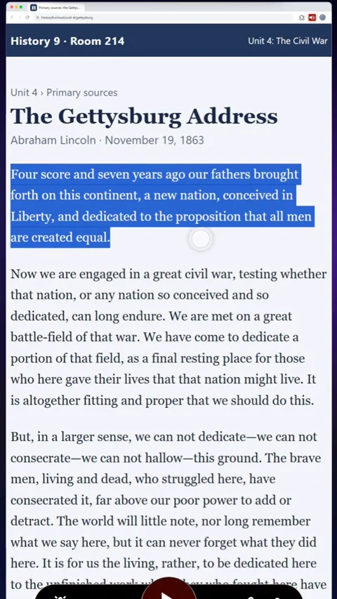
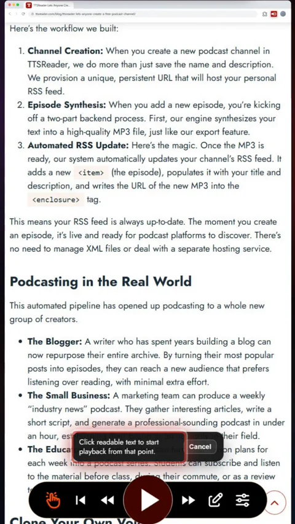
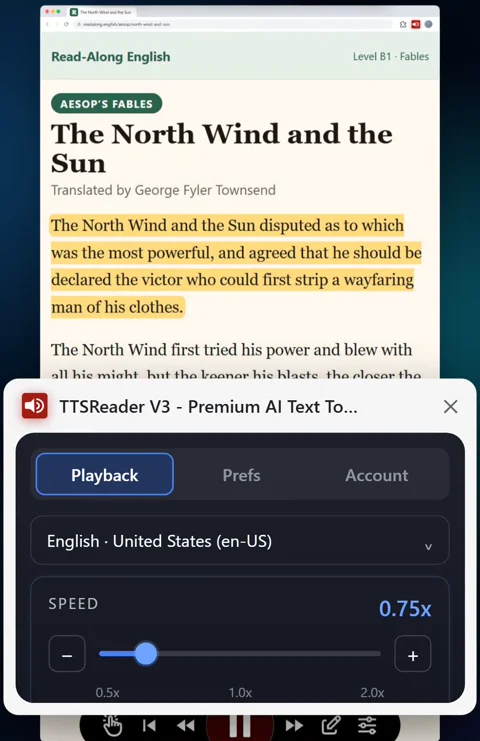

The TTSReader Chrome extension turns any website into voice.



*On your phone? Watch the [Short](https://youtube.com/shorts/g4I0Qn9MYDE).*

## Listen while you work

A long news piece on the Maple Street library, and an inbox waiting: press play on the article, go back to your inbox, and it keeps reading.

It works the same with a spreadsheet, a design or your research notes, and for a history class, a long blog post, learning English and your own writing.

## How to listen with the TTSReader Chrome extension

### 1. Add it to Chrome and pin it

Add TTSReader to Chrome, and pin it to your toolbar.

### 2. Click the icon and press play

Click the TTSReader icon, and press play on the player that appears, or right-click the page and choose **Play Page**. Each part lights up as it's read, and the page scrolls along.

### 3. Select a paragraph to hear only that

For a history class, select one paragraph of a speech, and it reads only that paragraph.

### 4. Start where you click

On a long blog post, press the hand button, click the paragraph you want, and it starts from there.

### 5. Set your pace

Set the speed from 0.5× to 2×: slow a fable down to three-quarter speed to learn English, or speed a long post up to one and a half.

### 6. Hear your own writing before you post it

Press the same button, click a text box, and hear your own writing.

## Free to start

Sign in with Google or Apple in the side panel, and the Basic voices are free. Premium adds more voices, like the one reading the library article. Add TTSReader to Chrome, and press play.

<a style="color:white;font-weight: bold" href="https://chromewebstore.google.com/detail/ttsreader-v3-premium-ai-t/kimpjeeihakmgdlnkjaapkdikpjccabi" target="_blank">👉 &nbsp; ADD TTSREADER TO CHROME</a>

 

No extension? [Open TTSReader in your browser](https://ttsreader.com/player/). More in the [guide to reading web pages](https://ttsreader.com/docs/guides/read_webpages/), the [story of the extension](https://ttsreader.com/blog/websites-reader-ttsreaderx-chrome-extension/), and the [TTSReader extension page](https://ttsreader.com/x/).


The TTSReader Chrome extension turns any website into voice. Listen to a long article while you work in another tab: your inbox, a spreadsheet, a design.

"The Maple Street library reopens on Saturday, with a reading garden, after a year of repairs."

Or take notes while it reads you the research. Add it to Chrome, and pin it to your toolbar. Click the TTSReader icon, and press play on the player that appears. Or right-click the page, and choose Play Page. Each part lights up as it's read, and the page scrolls along with it.

For a history class, select one paragraph of a speech, and it reads only that paragraph.

"Four score and seven years ago our fathers brought forth on this continent, a new nation, conceived in Liberty."

On a long blog post, press the hand button, click the paragraph you want, and it starts from there. Slow a fable down to three-quarter speed to learn English, or speed a long post up to one and a half. Press the same button, click a text box, and hear your own writing before you post it.

In the side panel, sign in with Google or Apple, and the Basic voices are free. With Premium, you get even more voices, like the one that read the article at the start. Add TTSReader to Chrome, and press play. ttsreader.com


*All speech in the video was produced with TTSReader: Nova Premium (the guide) and Adam Premium (the extension reading the page). The Gettysburg Address (Abraham Lincoln, 1863) and "The North Wind and the Sun" (Aesop's Fables, translated by George Fyler Townsend, 1867, [Project Gutenberg](https://www.gutenberg.org/ebooks/21)) are in the public domain. The news, class, fable and neighbourhood pages were written for the video; the sites are fictional.*
