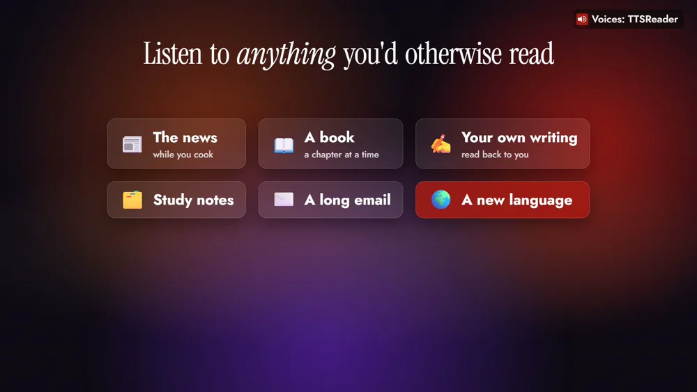
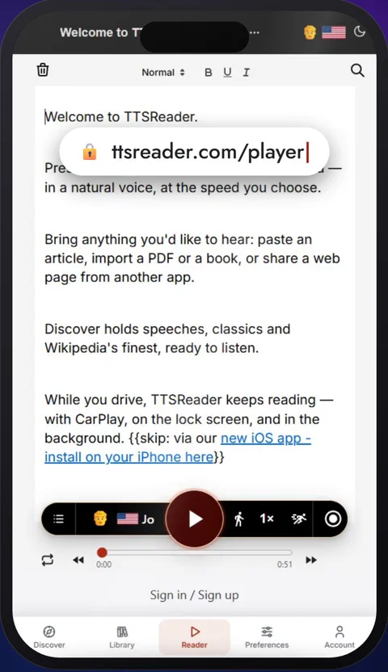
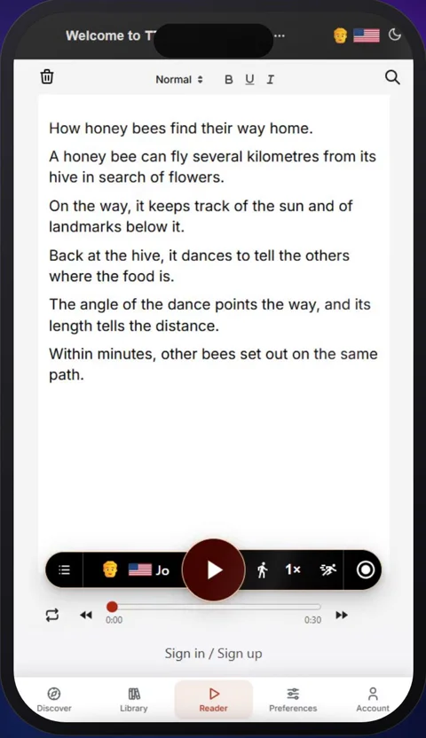
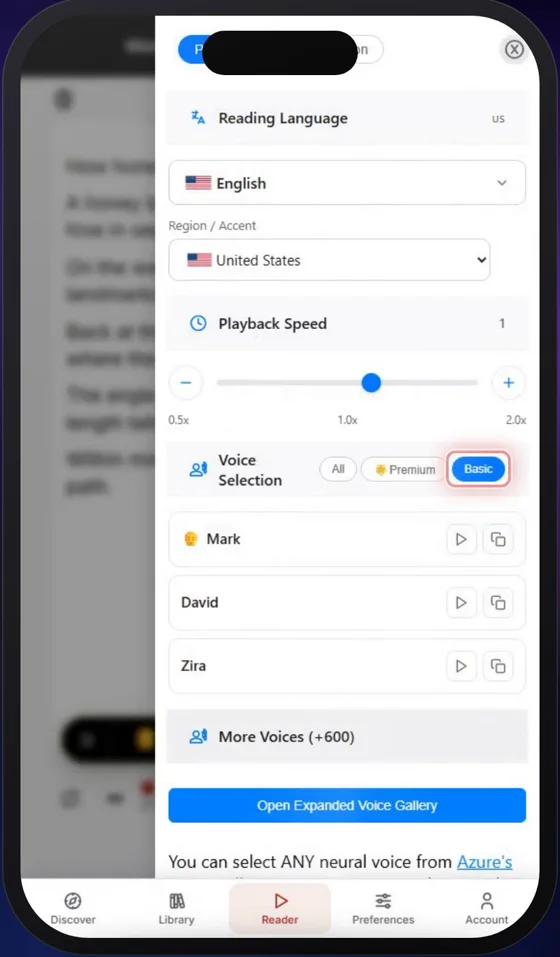
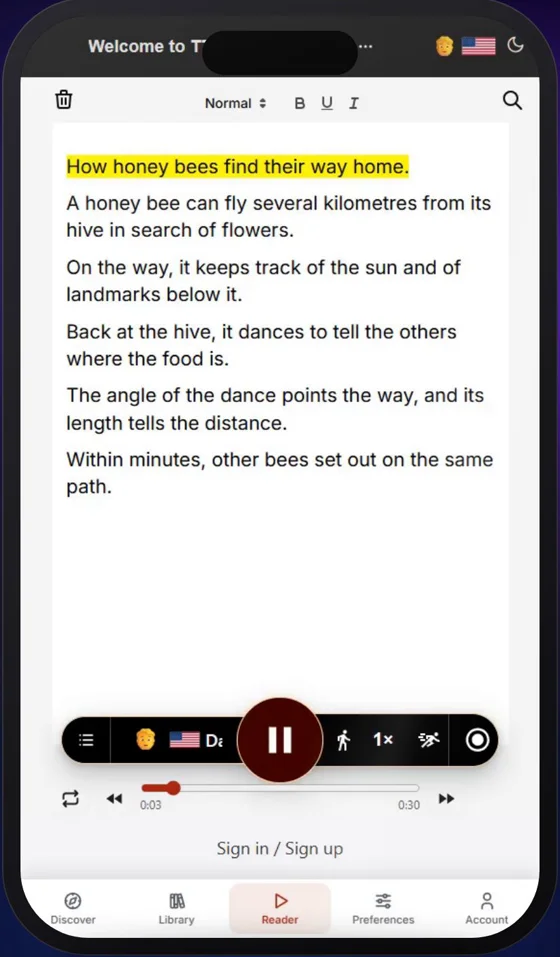
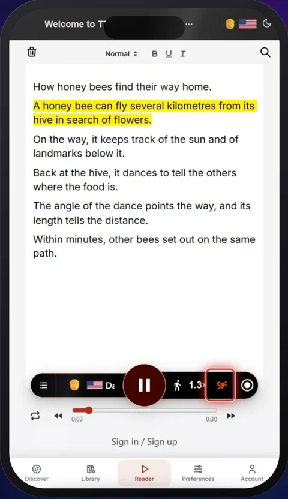
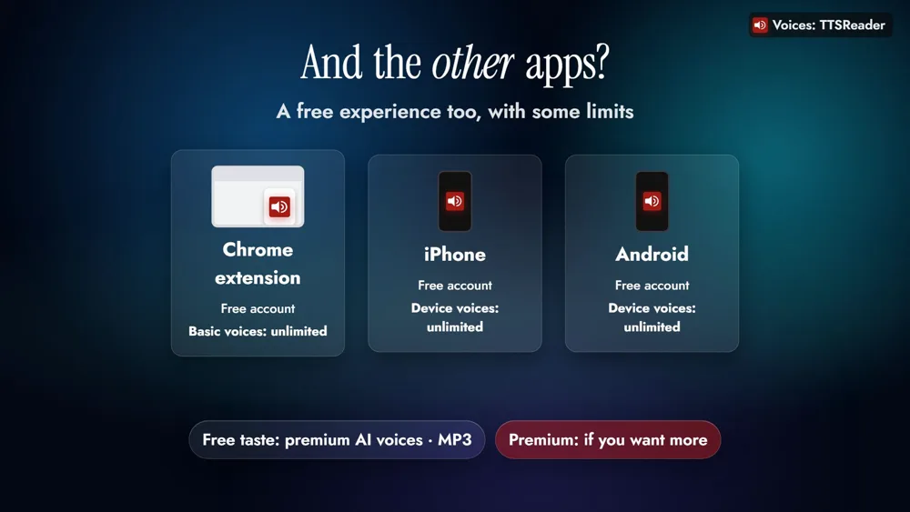

Is TTSReader free? Yes. The TTSReader web player has a completely free tier, and it's unlimited: no account, no time limit, and no ads.



*On your phone? Watch the [Short](https://youtube.com/shorts/UW6rw-lZies).*

## Listen to anything you'd otherwise read

In the video, it's a short article about how honey bees find their way home: paste it in, press play, and listen.

The bees stand in for anything you'd otherwise read: the news while you cook, a chapter of a book, your own writing, study notes, a long email, or a page in a language you're learning.

## How to use TTSReader for free

### 1. Open the web player

Open [ttsreader.com/player](https://ttsreader.com/player/) in your browser. There's nothing to sign up for.

### 2. Paste in your text

You can also open a file, or a web page by its address.

### 3. Choose a Basic voice

Tap the voice, choose **Basic**, and pick one you like. The Basic voices are the free ones, and they're unlimited.

### 4. Press play

TTSReader reads your text aloud and highlights each sentence as it goes.

### 5. Set your speed

You can change the speed at any time, faster or slower.

## The other apps have a free tier too

With some limits. Sign in with a free account, and the Chrome extension's Basic voices are unlimited; on iPhone and Android, the voices on your device are unlimited. You also get a free taste of the premium AI voices and MP3 downloads.

Premium adds natural AI voices, MP3 downloads, sync across your devices and AI features. The free plan is for personal use; for commercial use, the API, or a business or organization, see the [paid plans](https://ttsreader.com/docs/support/pricing/).

## Try it now

If it's text, TTSReader can read it to you, for free.

<a style="color:white;font-weight: bold" href="https://ttsreader.com/player/" target="_blank">👉 &nbsp; OPEN THE TTSREADER WEB PLAYER, FREE</a>

 

New to TTSReader? See the [quick start guide](https://ttsreader.com/docs/guides/quick-start-new-player/), or compare [plans and pricing](https://ttsreader.com/docs/support/pricing/).


Is TTSReader free? Yes, it is. The TTSReader web player has a completely free tier, and it's unlimited. No account, no time limit, and no ads.

Here's how to use it, step by step. First, open ttsreader.com/player in your browser. There's nothing to sign up for. Next, paste in your text. You can also open a file, or a web page by its address. Then tap the voice, choose Basic, and pick one you like. The Basic voices are the free ones, and they're unlimited. Now press play. TTSReader reads your text aloud and highlights each sentence as it goes. You can change the speed at any time, faster or slower.

With the free tier, you can listen to just about anything you'd otherwise read. Catch up on the news by listening to an article while you cook. Open a book and listen to a chapter, following each sentence as it's highlighted. Hear your own writing read back to you, and catch what your eyes skipped. Go over your study notes, a long email, or a page in a language you're learning. If it's text, TTSReader can read it to you, for free.

What about TTSReader's other apps? They offer a free experience too, with some limits. The Chrome extension reads the web pages you visit. Sign in with a free account, and its Basic voices are unlimited. On iPhone and Android, sign in for free, and the voices on your device are unlimited. You also get a free taste of the premium AI voices and MP3 downloads. Premium is there if you want more.

Every voice in this video was made with TTSReader.

Is TTSReader free? Yes. Try it now at ttsreader.com/player.


*Every voice in the video is AI-generated with TTSReader: Nova Premium (the guide). The footage is the real TTSReader web player, signed out, with the free Basic voice David; the article on screen was written for the video. Fonts: Jost, Inter and Instrument Serif, SIL Open Font License 1.1.*
