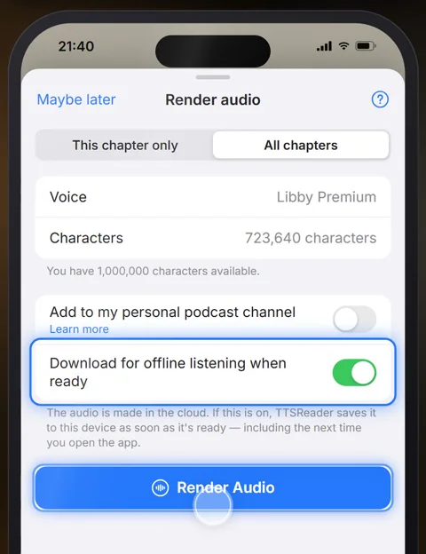
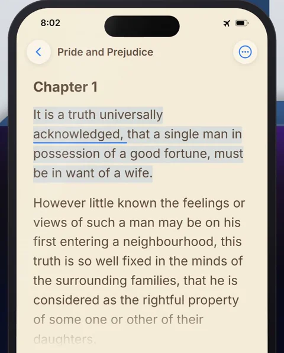
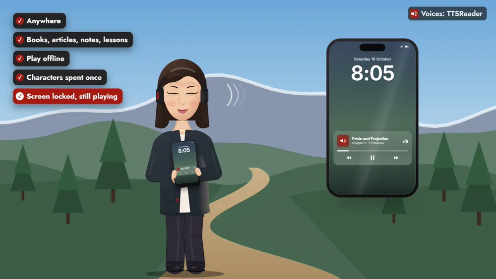
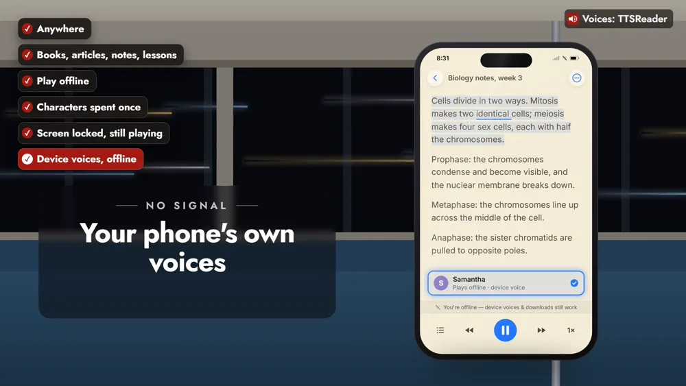

TTSReader plays your reading with no connection at all: on a flight, on a mountain trail, in a subway tunnel, or on a long drive where the signal comes and goes. Those are often the best hours of the day for reading and the worst for a connection. The premium voices are made in the cloud, so the TTSReader app on your phone lets you render a book while you're still online, keep the audio on the phone, and play it wherever you end up.

<!-- AMIEL: optional, one or two lines of your own here. Delete this comment when done. -->



*On your phone? Watch the [one-minute Short](https://youtube.com/shorts/aI_INHMODVo).*

Take *Pride and Prejudice*, the night before a flight. Open the book in the app, choose **Render Audio** from its ⋯ menu, pick a premium voice and **All chapters**, and turn on **Download for offline listening when ready**. The audio is made in the cloud, and with that switch on, TTSReader saves it to your phone as soon as it's ready, even if that's the next time you open the app.

The next morning, in seat 23A with airplane mode on, open the ⋯ menu and tap **Play offline**. The novel starts at its famous first line, and the sentence being read is highlighted as it goes.

> "It is a truth universally acknowledged, that a single man in possession of a good fortune, must be in want of a wife."

Rendering spends characters from your account once. After that the audio is yours to play as often as you like, and playing it again costs nothing more. It also keeps playing when the app is closed or the screen is locked, so on a mountain trail the phone can go into a jacket pocket while the chapter carries on, with the controls on the lock screen.

A novel is only one kind of reading. The same goes for a long article, your study notes, or a lesson on something new. And much of it needs no rendering at all: your phone's own device voices read your documents offline too, with nothing to download first. Open your biology notes in a subway tunnel and press play; the app tells you it's offline and reads on with the phone's voice.

On the trail, in the tunnel, or high above the clouds, your reading goes with you. Download before you go, and listen anywhere.

<a style="color:white;font-weight: bold" href="https://apps.apple.com/us/app/ttsreader-text-to-speech/id6790834349" target="_blank">👉 &nbsp; GET TTSREADER ON THE APP STORE</a>

 

Prefer your computer? [Open TTSReader in your browser](https://ttsreader.com/player/). New to the app? See the [quick start guide](https://ttsreader.com/docs/guides/quick-start-new-player/) and the [first look at TTSReader for iPhone](https://ttsreader.com/blog/ttsreader-for-iphone-a-first-look-at-our-new-mobile-app/). Something to take with you? [All of Project Gutenberg and LibriVox are in TTSReader](https://ttsreader.com/blog/ttsreader-now-holds-all-of-project-gutenberg-and-all-of-librivox-with-5000-hours-of-human-narration-synced-to-the-text/), for listening offline too.


Listen offline, anywhere, with TTSReader. On a flight, on a mountain trail, in a subway tunnel, or on a long drive with patchy signal. Take a novel, a long article, your study notes, or a lesson on something new.

Here's Pride and Prejudice, the night before a flight. Open the book and tap Render Audio. Pick a premium voice and All chapters, then turn on Download for offline listening. On board, with airplane mode on, tap Play offline.

"It is a truth universally acknowledged, that a single man in possession of a good fortune, must be in want of a wife."

Play it as often as you like: the characters are spent once. It keeps playing with the screen locked, right from your pocket. And your phone's own voices read your documents offline too, with nothing to download.

On the trail, in the tunnel, or high above the clouds, your reading goes with you. Download before you go, and listen anywhere.


*All speech in the video was produced with TTSReader: Nova Premium (the guide) and Libby Premium (the book). Pride and Prejudice by Jane Austen (1813) is in the public domain.*
