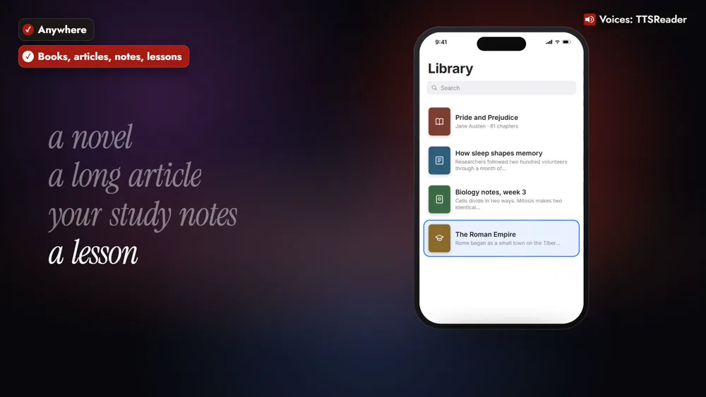
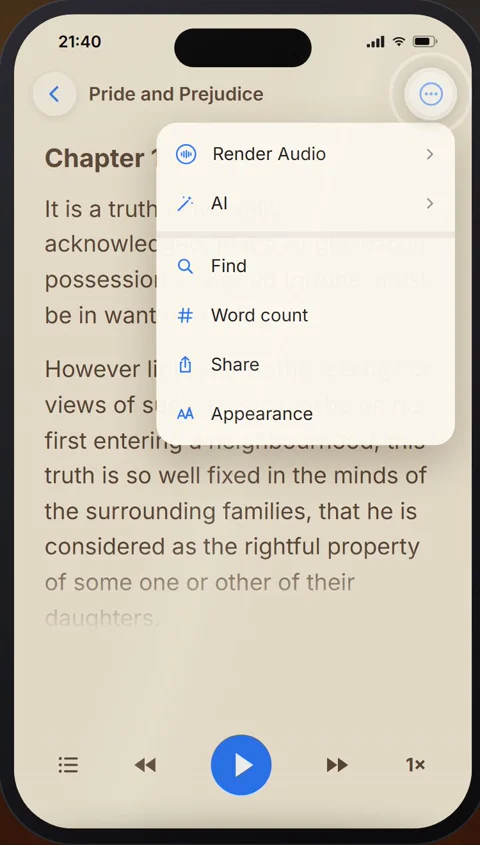

Listen offline, anywhere: download your reading with TTSReader, and play it with no connection at all.



*On your phone? Watch the [one-minute Short](https://youtube.com/shorts/aI_INHMODVo).*

## Your reading, with no connection

Take *Pride and Prejudice*, the night before a flight. You download it in the TTSReader app, and in seat 23A, with airplane mode on, it reads aloud.

The same goes for a mountain trail, a subway tunnel, or a long drive with patchy signal, and for a long article, your study notes, or a lesson on something new.

## How to listen offline with TTSReader

### 1. Open the book and tap Render Audio

The night before, open the book's ⋯ menu and tap **Render Audio**.

### 2. Pick a premium voice and All chapters, and turn on Download

Pick a premium voice and **All chapters**, then turn on **Download for offline listening when ready**.

### 3. On board, tap Play offline

With airplane mode on, open the ⋯ menu and tap **Play offline**.

> "It is a truth universally acknowledged, that a single man in possession of a good fortune, must be in want of a wife."

## Play it as often as you like

The characters are spent once; play the downloaded audio as often as you like. It keeps playing with the screen locked, right from your pocket.

## Your phone's own voices read offline too

Your phone's device voices read your documents offline, with nothing to download.

## Listen anywhere

On the trail, in the tunnel, or high above the clouds, your reading goes with you. Download before you go, and listen anywhere.

<a style="color:white;font-weight: bold" href="https://apps.apple.com/us/app/ttsreader-text-to-speech/id6790834349" target="_blank">👉 &nbsp; GET TTSREADER ON THE APP STORE</a>

 

Prefer your computer? [Open TTSReader in your browser](https://ttsreader.com/player/). New to the app? See the [quick start guide](https://ttsreader.com/docs/guides/quick-start-new-player/) and the [first look at TTSReader for iPhone](https://ttsreader.com/blog/ttsreader-for-iphone-a-first-look-at-our-new-mobile-app/). Something to take with you? [All of Project Gutenberg and LibriVox are in TTSReader](https://ttsreader.com/blog/ttsreader-now-holds-all-of-project-gutenberg-and-all-of-librivox-with-5000-hours-of-human-narration-synced-to-the-text/).


Listen offline, anywhere, with TTSReader. On a flight, on a mountain trail, in a subway tunnel, or on a long drive with patchy signal. Take a novel, a long article, your study notes, or a lesson on something new.

Here's Pride and Prejudice, the night before a flight. Open the book and tap Render Audio. Pick a premium voice and All chapters, then turn on Download for offline listening. On board, with airplane mode on, tap Play offline.

"It is a truth universally acknowledged, that a single man in possession of a good fortune, must be in want of a wife."

Play it as often as you like: the characters are spent once. It keeps playing with the screen locked, right from your pocket. And your phone's own voices read your documents offline too, with nothing to download.

On the trail, in the tunnel, or high above the clouds, your reading goes with you. Download before you go, and listen anywhere.


*All speech in the video was produced with TTSReader: Nova Premium (the guide) and Libby Premium (the book). Pride and Prejudice by Jane Austen (1813) is in the public domain.*
