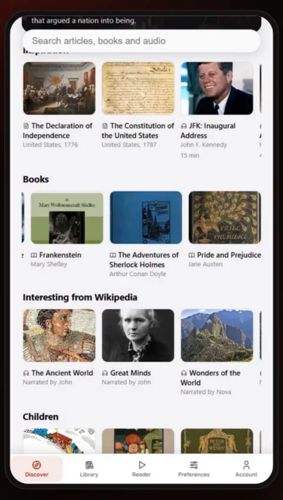
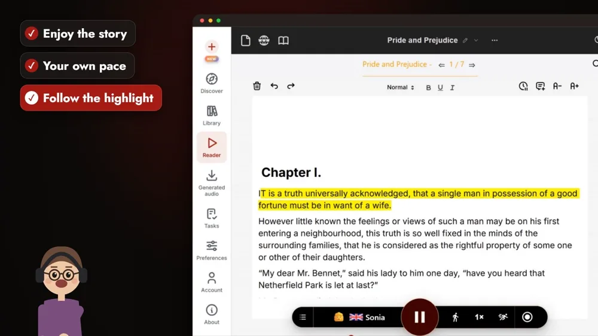
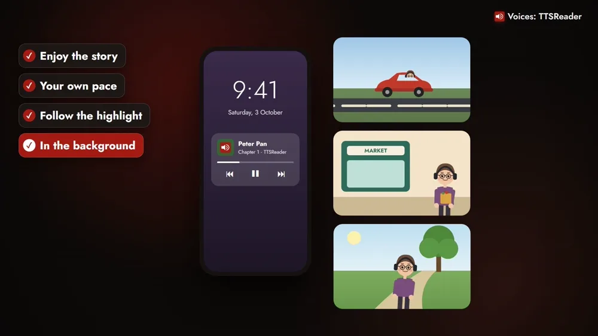

TTSReader reads the classics to you. We have put hundreds of the world's greatest books in the app, open and at no extra cost, and any book from Project Gutenberg comes in with its link. With a voice reading, a great novel fits into the hours you spend driving, running errands or out on a walk.

<!-- AMIEL: optional, one or two lines of your own here. Delete this comment when done. -->



*On your phone? Watch the [Short](https://youtube.com/shorts/TjYmrWfF-Yk).*

Every great story starts with a first line: "Call me Ishmael." "All children, except one, grow up." "To Sherlock Holmes she is always the woman." TTSReader reads the rest to you. Take *Pride and Prejudice*. Open the **Discover** tab and it's on the **Books** shelf, next to *Frankenstein* and *The Adventures of Sherlock Holmes*, with *Peter Pan* further down on the Children shelf.

Sign in with a free account, tap the book, and it opens chapter by chapter, at Chapter I. Press play, and "It is a truth universally acknowledged, that a single man in possession of a good fortune must be in want of a wife." begins. The sentence being read lights up as it goes, so you can follow along with your eyes when you want to. Set the pace that suits you, faster or slower.

On your phone, it keeps playing in the background, with the screen locked. The Bennet sisters come along while you drive, shop at the market or walk in the park. When you finish, *Moby-Dick*, *Anna Karenina* and the rest of the shelf are there, or bring a book from Project Gutenberg by pasting its link.

The classics are open to everyone with a free account, at no extra cost. With Premium, you can also download chapters as MP3s and listen offline, anywhere. Every voice in the video, including the three that read the first lines, was made with TTSReader. Pick a classic, and press play.

<a style="color:white;font-weight: bold" href="https://ttsreader.com/player/" target="_blank">👉 &nbsp; OPEN TTSREADER AND PICK A CLASSIC</a>

 

There's more in the library, too: [classics read by real people, synced to the text](https://ttsreader.com/blog/ttsreader-now-holds-all-of-project-gutenberg-and-all-of-librivox-with-5000-hours-of-human-narration-synced-to-the-text/). Taking a book on a trip? See how to [listen offline, anywhere](https://ttsreader.com/blog/listen-offline-anywhere-download-your-reading-with-ttsreader/).


Use TTSReader to listen to classic literature.

Call me Ishmael. All children, except one, grow up. To Sherlock Holmes she is always the woman.

Hundreds of the world's greatest classics are ready for you, open and at no extra cost. Open Discover, pick a book, and press play. Then sit back and enjoy a great story.

Listen at your own pace, faster or slower. Follow along as each sentence is highlighted. On your phone, it keeps playing in the background, while you drive, run errands, or go for a walk. And with Premium, download chapters to listen offline.

Every voice in this video was made with TTSReader. Pick a classic, and press play. ttsreader.com


*Every voice in the video is AI-generated with TTSReader: Nova Premium (the guide), Davis Premium, Libby Premium and Noah Premium (the books). Classic texts: Project Gutenberg (public domain), [gutenberg.org](https://www.gutenberg.org). First lines from Moby-Dick (Herman Melville), Peter Pan (J. M. Barrie) and The Adventures of Sherlock Holmes (Arthur Conan Doyle).*
