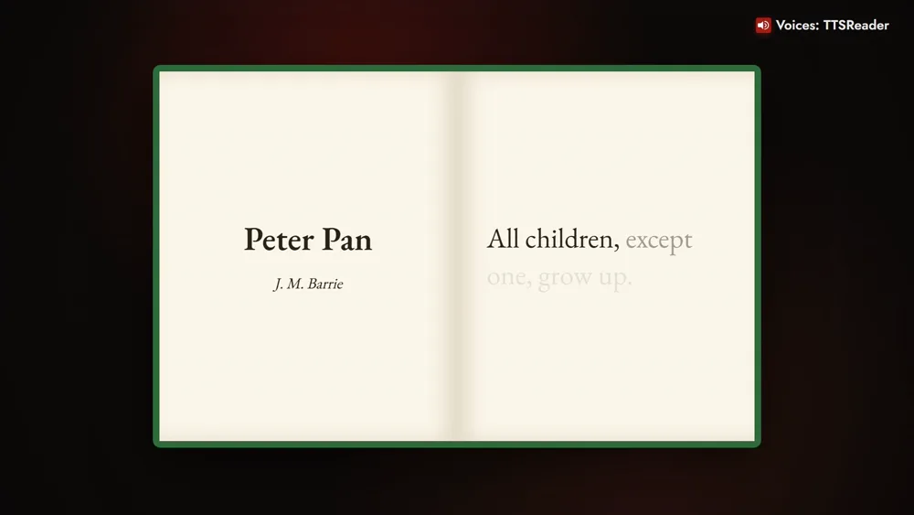
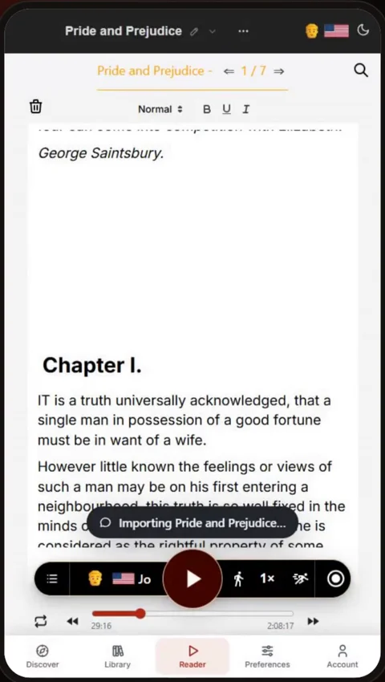
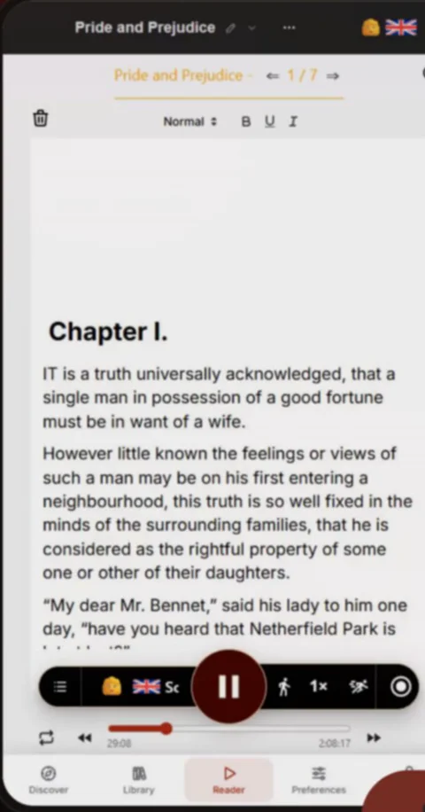
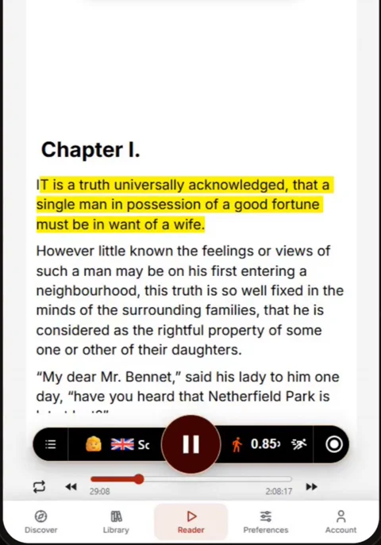

Hundreds of the world's greatest classics are ready for you in TTSReader, open and at no extra cost.



*On your phone? Watch the [Short](https://youtube.com/shorts/TjYmrWfF-Yk).*

## Every great story starts with a first line

"Call me Ishmael." "All children, except one, grow up." "To Sherlock Holmes she is always the woman." TTSReader reads the rest to you.

Choose *Moby-Dick*, *Pride and Prejudice* or *Anna Karenina*, or bring any book from Project Gutenberg with its link, and take the story along while you drive, run errands, or walk.

## How to listen to classic literature with TTSReader

### 1. Open Discover

Open the **Discover** tab: the classics are on the **Books** shelf.

### 2. Pick a book

Sign in with a free account, tap a book, and it opens chapter by chapter.

### 3. Press play

Press play, then sit back and enjoy a great story.

### 4. Listen at your own pace

Listen faster or slower.

### 5. Follow along

Each sentence is highlighted as it's read.

## Keep listening in the background

On your phone, it keeps playing in the background, while you drive, run errands, or go for a walk.

## Offline with Premium

With Premium, download chapters as MP3s to listen offline, anywhere.

## Pick a classic

Every voice in the video was made with TTSReader. Pick a classic, and press play.

<a style="color:white;font-weight: bold" href="https://ttsreader.com/player/" target="_blank">👉 &nbsp; OPEN TTSREADER AND PICK A CLASSIC</a>

 

There's more in the library, too: [classics read by real people, synced to the text](https://ttsreader.com/blog/ttsreader-now-holds-all-of-project-gutenberg-and-all-of-librivox-with-5000-hours-of-human-narration-synced-to-the-text/). Taking a book on a trip? See how to [listen offline, anywhere](https://ttsreader.com/blog/listen-offline-anywhere-download-your-reading-with-ttsreader/).


Use TTSReader to listen to classic literature.

Call me Ishmael. All children, except one, grow up. To Sherlock Holmes she is always the woman.

Hundreds of the world's greatest classics are ready for you, open and at no extra cost. Open Discover, pick a book, and press play. Press play, then sit back and enjoy a great story.

Listen at your own pace, faster or slower. Follow along as each sentence is highlighted. On your phone, it keeps playing in the background, while you drive, run errands, or go for a walk. And with Premium, download chapters to listen offline.

Every voice in this video was made with TTSReader. Pick a classic, and press play. ttsreader.com


*Every voice in the video is AI-generated with TTSReader: Nova Premium (the guide), Davis Premium, Libby Premium and Noah Premium (the books). Classic texts: Project Gutenberg (public domain), [gutenberg.org](https://www.gutenberg.org). First lines from Moby-Dick (Herman Melville), Peter Pan (J. M. Barrie) and The Adventures of Sherlock Holmes (Arthur Conan Doyle).*
