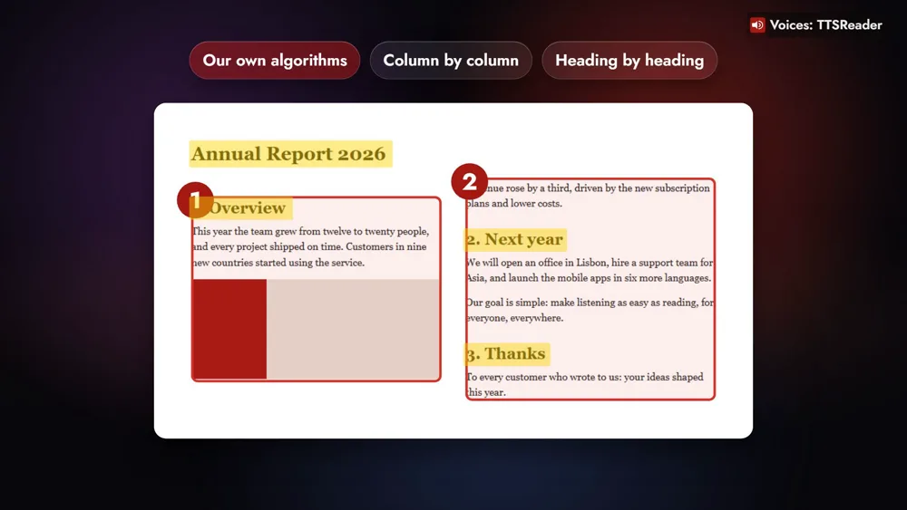
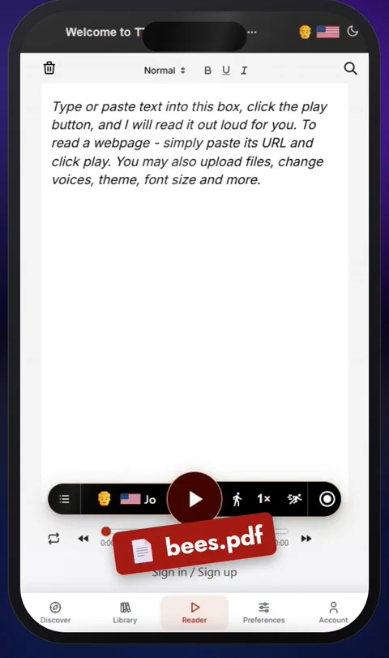
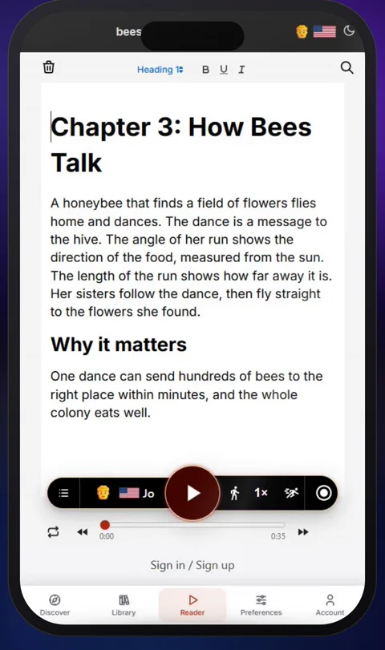
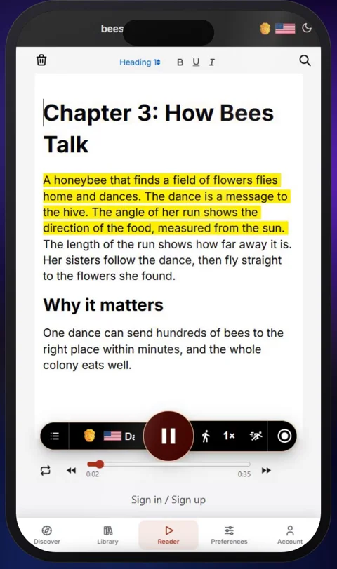
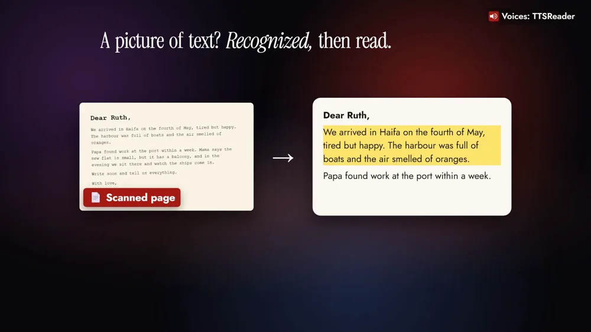

TTSReader turns any PDF into audio, whether it's a text document or a scanned page.



*On your phone? Watch the [Short](https://youtube.com/shorts/_4w5aIPdaf0).*

## The PDFs you meant to read

Take the report you were sent the night before a meeting: two columns, a heading over each section. Your eye reads it column by column without thinking about it. TTSReader reads it the same way, so the report simply plays while you get ready for the meeting it's about.

A student listens to a textbook chapter on the bus. A researcher listens to papers on a walk. And a scanned family letter is heard again, in a clear voice.

## How to turn a PDF into audio

### 1. Open ttsreader.com/player and upload your PDF

Open [ttsreader.com/player](https://ttsreader.com/player/) and upload your PDF.

### 2. Its text is in the editor

In a few seconds, its text is in the editor, ready to read.

### 3. Press play

Press play, and TTSReader reads it aloud, highlighting each sentence as it goes.

## Every layout, scans included

Real PDFs come in every layout: reports in two columns, papers full of headings, pages scanned from a book. Our own algorithms read a page the way you would: column by column, heading by heading, in the right order. And when a page is only a picture, like a scan or a photo, TTSReader first recognizes the text on it, then reads it to you.

## Take it with you as an MP3

Download the audio as an MP3, and play it on your phone, in the car, or offline.

## Is it free?

Listening to your PDFs with the Basic voices is free and unlimited. Premium adds the natural AI voices, like the one narrating the video, and MP3 downloads ([plans and pricing](https://ttsreader.com/docs/support/pricing/)).

## Any PDF, turned into audio

Any PDF, text or scanned, turned into audio.

<a style="color:white;font-weight: bold" href="https://ttsreader.com/player/" target="_blank">👉 &nbsp; OPEN TTSREADER AND UPLOAD A PDF</a>

 

New to TTSReader? The [quick start guide](https://ttsreader.com/docs/guides/quick-start-new-player/) walks through the player. Taking your audio on a trip? Read [Listen Offline, Anywhere](https://ttsreader.com/blog/listen-offline-anywhere-download-your-reading-with-ttsreader/).


TTSReader turns any PDF into audio, whether it's a text document or a scanned page. Upload it, press play, and listen. Or save it as an MP3 and take it with you.

It takes three steps. Open ttsreader.com/player and upload your PDF. In a few seconds, its text is in the editor, ready to read. Press play, and TTSReader reads it aloud, highlighting each sentence as it goes.

Real PDFs come in every layout: reports in two columns, papers full of headings, pages scanned from a book. So we developed our own algorithms to read a page the way you would: column by column, heading by heading, in the right order. And when a page is only a picture, like a scan or a photo, TTSReader first recognizes the text on it, then reads it to you.

That turns the PDFs you meant to read into something you can listen to, anywhere. A student uploads a textbook chapter and listens to it on the bus. At work, a long report plays while you get ready for the meeting. A researcher listens to papers on a walk. And a scanned family letter is heard again, in a clear voice.

To take it with you, download the audio as an MP3, and play it on your phone, in the car, or offline.

Is it free? Listening to your PDFs with the Basic voices is free and unlimited. Premium adds the natural AI voices you're hearing now, and MP3 downloads.

Every voice in this video was made with TTSReader. Any PDF, text or scanned, turned into audio. ttsreader.com/player


*All speech in the video was produced with TTSReader: Nova Premium (the guide). The documents on screen were made for the video.*
