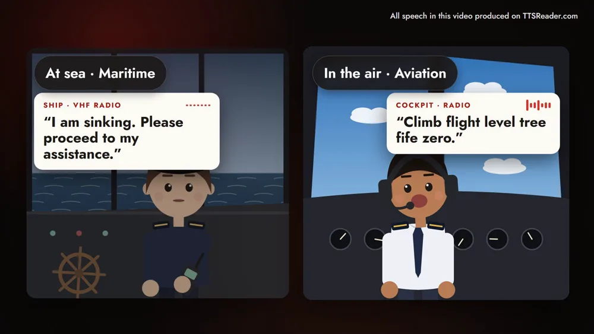
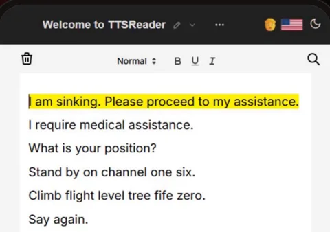
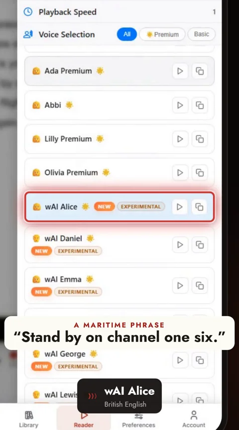
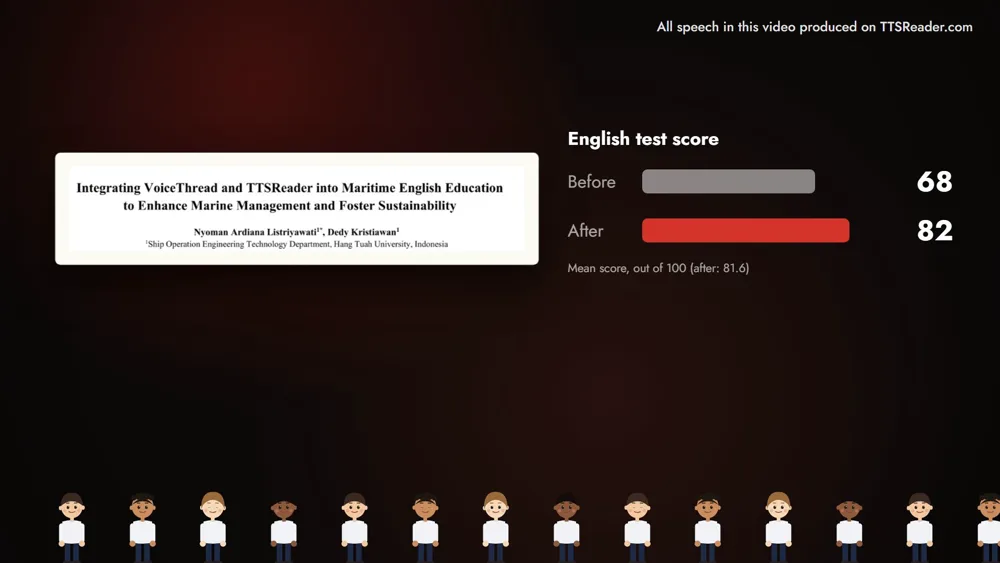

TTSReader reads your field's radio phrases aloud, in more than one accent and as slowly as you need, so you can say them back until they're yours. At sea and in the air that practice matters, because there a misheard word is a safety problem.

<!-- AMIEL: optional, one or two lines of your own here. Delete this comment when done. -->



*On your phone? Watch the [Short](https://youtube.com/shorts/ESD_fjIfR8E).*

That's why these professions speak by a code. Ships use the IMO's Standard Marine Communication Phrases; pilots use ICAO radiotelephony phraseology, where three is "tree" and nine is "niner". Fixed words, said the same way by crews from every country. A distress call at sea runs *"I am sinking. Please proceed to my assistance."*; a pilot's call in the air, *"Climb flight level tree fife zero."*

A code like that is learned out loud. Take a cadet's list of six phrases: the distress call, "I require medical assistance.", "What is your position?", "Stand by on channel one six.", a flight-level call and "Say again." Paste the list into TTSReader, one phrase per line, and press play. Each phrase is read aloud and highlighted as it goes, so you see the words while you hear them.

Crews come from everywhere, so the next thing to train is another accent. Switch voices, and the same phrase, "Stand by on channel one six.", comes back in wAI Alice's British English, then in wAI Daniel's.

When a phrase is hard to catch, slow it down, all the way to 0.5×. Turn on **Loop**, and the list plays again from the top while you say each phrase back. The same drill works in the control tower or at the emergency radio: wherever there's a code, paste in your own. The phrases in the video are short examples we wrote in the style of each code, so train with your own organisation's approved phrase list.

TTSReader has also been part of a classroom. In 2025, Hang Tuah University in Indonesia brought TTSReader into its Maritime English classes, together with VoiceThread. 84 cadets took part, and their mean English test score rose from 68 to 81.6 (out of 100). Asked afterwards, 85% said their vocabulary grew, and 83% said they communicated better in navigation tasks. It was one programme with no control group, the percentages are what the cadets reported, and the results belong to the whole programme, which also used VoiceThread.

Wherever there's a code, practice it out loud. Open the player, paste in your phrase list, and press play.

<a style="color:white;font-weight: bold" href="https://ttsreader.com/player/" target="_blank">👉 &nbsp; OPEN TTSREADER AND PASTE YOUR PHRASES</a>

 

[Open TTSReader in your browser](https://ttsreader.com/player/) and paste in your phrase list. New to TTSReader? See the [quick start guide](https://ttsreader.com/docs/guides/quick-start-new-player/). More on voices: the [voiceover guide](https://ttsreader.com/docs/guides/voiceover/).


TTSReader for professional communication development.

At sea, a maritime distress call. "I am sinking. Please proceed to my assistance." In the air, a pilot's radio call. "Climb flight level tree fife zero." At sea and in the air, a misheard word is a safety problem.

So ships speak by the IMO's standard marine phrases. Pilots speak by ICAO phraseology: three is tree, nine is niner. Fixed words, said the same way, by crews from every country.

In 2025, Hang Tuah University in Indonesia brought TTSReader into its Maritime English classes, with VoiceThread. Eighty-four cadets. Test scores up from 68 to 82. 85 percent said their vocabulary grew. 83 percent said they communicated better in navigation.

Step one: paste in the phrases of your own field. Step two: listen. TTSReader reads each phrase and highlights it. Then switch voices, and hear it in another accent. A maritime phrase: "Stand by on channel one six." "Stand by on channel one six."

Step three: slow it down, turn on Loop, and say it back until it's yours.

The bridge. The cockpit. The control tower. The emergency radio.

Wherever there's a code, practice it out loud. ttsreader.com


*All speech in the video was produced with TTSReader: Steven Premium (American English, narrator), wAI Alice and wAI Daniel (British English). Study: Listriyawati, N. A., & Kristiawan, D. (2025). Integrating VoiceThread and TTSReader into Maritime English Education to Enhance Marine Management and Foster Sustainability. Saintara: Jurnal Ilmiah Ilmu-Ilmu Maritim, 9(2), 161–171. [https://doi.org/10.52475/saintara.v9i2.399](https://doi.org/10.52475/saintara.v9i2.399). Open access under a Creative Commons Attribution-ShareAlike 4.0 license ([CC BY-SA 4.0](https://creativecommons.org/licenses/by-sa/4.0/)). The paper's title block is shown unchanged; the charts are drawn from its Tables 1 and 5.*
