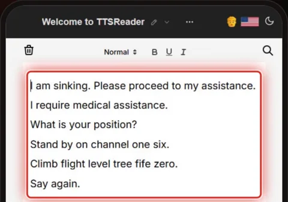
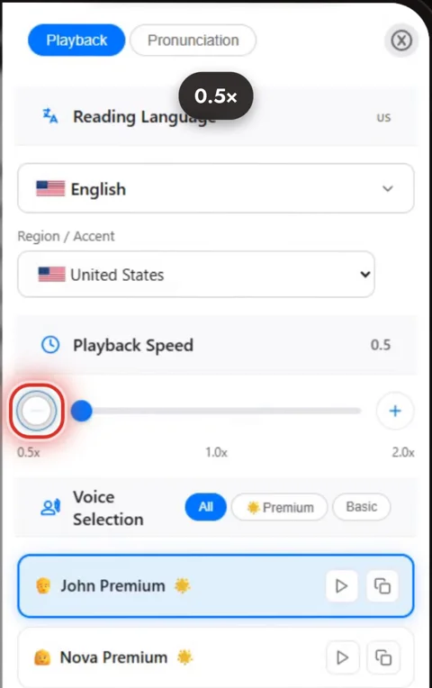

Practice your field's radio phrases out loud with TTSReader, until they're yours.



*On your phone? Watch the [Short](https://youtube.com/shorts/ESD_fjIfR8E).*

## A code you learn out loud

At sea, a distress call: *"I am sinking. Please proceed to my assistance."* In the air, a pilot's call: *"Climb flight level tree fife zero."* A misheard word is a safety problem, so ships speak by the IMO's Standard Marine Communication Phrases, and pilots by ICAO radiotelephony, where three is "tree" and nine is "niner": fixed words, said the same way by crews from every country.

The same practice works on the bridge, in the cockpit, in the control tower and at the emergency radio.

## How to practice your field's phrases

### 1. Paste in your phrases

Paste your phrase list into TTSReader, one phrase per line.

### 2. Listen

TTSReader reads each phrase aloud and highlights it as it goes.

Then switch voices to hear the same phrase in another accent.

### 3. Slow it down, loop it, say it back

Slow it down, all the way to 0.5×. Turn on **Loop**, and say each phrase back until it's yours.

Train with your own organisation's approved phrase list; the ones in the video are short examples.

## What a study found

In 2025, Hang Tuah University in Indonesia brought TTSReader into its Maritime English classes, together with VoiceThread. The 84 cadets' mean English test score rose from 68 to 81.6; 85% said their vocabulary grew, and 83% that they communicated better in navigation tasks. One programme, no control group, self-reported percentages, and the results belong to the whole programme, VoiceThread included.

## Practice it out loud

Wherever there's a code, practice it out loud. Open the player, paste in your phrase list, and press play.

<a style="color:white;font-weight: bold" href="https://ttsreader.com/player/" target="_blank">👉 &nbsp; OPEN TTSREADER AND PASTE YOUR PHRASES</a>

 

New to TTSReader? See the [quick start guide](https://ttsreader.com/docs/guides/quick-start-new-player/). More on voices: the [voiceover guide](https://ttsreader.com/docs/guides/voiceover/).


TTSReader for professional communication development.

At sea, a maritime distress call. "I am sinking. Please proceed to my assistance." In the air, a pilot's radio call. "Climb flight level tree fife zero." At sea and in the air, a misheard word is a safety problem.

So ships speak by the IMO's standard marine phrases. Pilots speak by ICAO phraseology: three is tree, nine is niner. Fixed words, said the same way, by crews from every country.

In 2025, Hang Tuah University in Indonesia brought TTSReader into its Maritime English classes, with VoiceThread. Eighty-four cadets. Test scores up from 68 to 82. 85 percent said their vocabulary grew. 83 percent said they communicated better in navigation.

Step one: paste in the phrases of your own field. Step two: listen. TTSReader reads each phrase and highlights it. Then switch voices, and hear it in another accent. A maritime phrase: "Stand by on channel one six." "Stand by on channel one six."

Step three: slow it down, turn on Loop, and say it back until it's yours.

The bridge. The cockpit. The control tower. The emergency radio.

Wherever there's a code, practice it out loud. ttsreader.com


*All speech in the video was produced with TTSReader: Steven Premium (American English, narrator), wAI Alice and wAI Daniel (British English). Study: Listriyawati, N. A., & Kristiawan, D. (2025). Integrating VoiceThread and TTSReader into Maritime English Education to Enhance Marine Management and Foster Sustainability. Saintara: Jurnal Ilmiah Ilmu-Ilmu Maritim, 9(2), 161–171. [https://doi.org/10.52475/saintara.v9i2.399](https://doi.org/10.52475/saintara.v9i2.399). Open access under a Creative Commons Attribution-ShareAlike 4.0 license ([CC BY-SA 4.0](https://creativecommons.org/licenses/by-sa/4.0/)). The paper's title block is shown unchanged; the charts are drawn from its Tables 1 and 5.*
