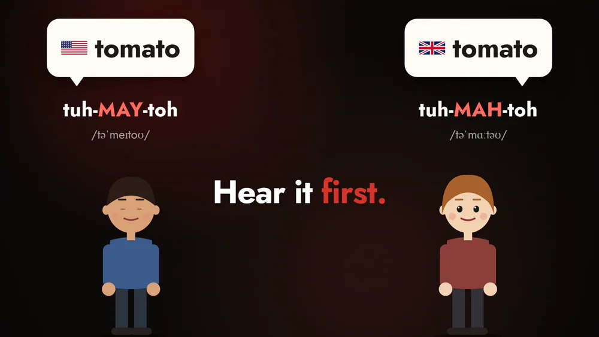
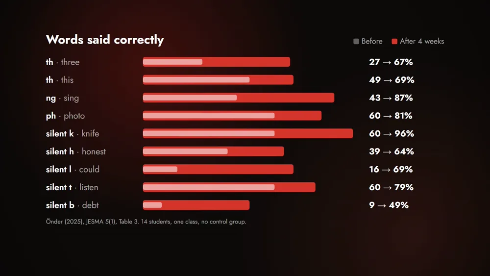
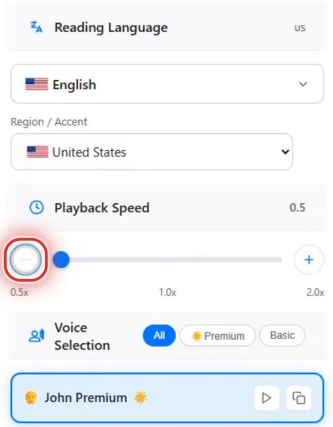
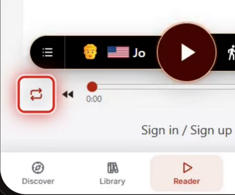

To say a word right, you first have to hear it. TTSReader lets a learner hear English read aloud in the accent they are learning, at their own speed, as often as they need. In 2025 a study measured what that did for beginners who practiced pronunciation with it.

<!-- AMIEL: optional, one or two lines of your own here. Delete this comment when done. -->



*On your phone? Watch the [Short](https://youtube.com/shorts/DI2uQutpsg8).*

"Tomato" shows the problem in one word. I say *tomayto*, you say *tomahto*: American English says tuh-MAY-toh, British English says tuh-MAH-toh, and both are correct. A learner reading the word on a page sees the same six letters either way. The difference is only in the sound, so the sound is where good pronunciation starts.

The study was done at a university in Türkiye. Fourteen university students, beginners in English, practiced with TTSReader for four weeks. Their teacher projected a passage, and they listened while TTSReader read it aloud and highlighted each sentence. Then they read it back themselves, as many times as they needed. Their pronunciation improved in all nine sound groups tested: the "th" sounds, "ng", "ph", and the silent letters k, h, l, t and b. The "ng" sound, as in *sing*, went from 43% to 87% correct, and the silent l in *could* from 16% to 69%. All fourteen students said it can lower their anxiety about pronunciation. One class of 14, four weeks, no control group: the author reports these limits herself.

You can practice the same way on your own. Open a passage in the [TTSReader web player](https://ttsreader.com/player/) and pick the accent you're learning: switch the region to **United States** or **United Kingdom** and choose a voice. The video uses John Premium for American English and wAI Alice for British. Then tap the **−** button under **Playback Speed** until it reaches half speed (0.5×), and a long word comes apart into its syllables: pro·nun·ci·a·tion.

Last, turn on **Loop**, and the text plays again from the top each time it ends. Listen, say it back, and compare, as many times as you need.

A teacher can run it the way the study did: project a passage and let TTSReader read it, a model voice that repeats it as often as the class needs. Pick your accent, slow it down, and loop it.

<a style="color:white;font-weight: bold" href="https://ttsreader.com/player/" target="_blank">👉 &nbsp; TRY TTSREADER NOW</a>

 

New to TTSReader? See the [quick start guide](https://ttsreader.com/docs/guides/quick-start-new-player/). Related read: the [pronunciation dictionary](https://ttsreader.com/blog/ttsreader-pronunciation-dictionary-custom-pronunciation-control-for-text-to-speech/), about the other side of pronunciation: setting how TTSReader itself says a word.


Learning a new language? Use TTSReader to refine pronunciation.

I say tomayto. I say tomahto. Same word, two correct ways to say it. To say a word right, you first have to hear it.

In 2025, a study in Türkiye tested this with TTSReader. Fourteen university students, beginners in English, practiced with it for four weeks.

They listened to a passage while TTSReader read it aloud and highlighted each sentence. Then they read it back themselves, as many times as they needed.

Their pronunciation improved in all nine sound groups tested. The ng sound, as in sing, went from 43 to 87 percent correct. The silent l in could went from 16 to 69 percent. And all fourteen said it can lower their anxiety about pronunciation.

You can practice the same way on your own. Pick the accent you're learning. American, or British. Slow it down, all the way to half speed. Pronunciation. Turn on Loop, and it plays again from the top. Listen, say it back, and compare.

In class, it's a model voice that repeats a passage as often as your students need.

ttsreader.com


*Narration: AI-generated voices from TTSReader: John Premium (American English) and wAI Alice (British English). Study: Önder, F. (2025). The Effectiveness of Online Text-To-Speech Tools in Improving EFL Students' Pronunciation. Journal of Educational Studies and Multidisciplinary Approaches (JESMA), 5(1), 29–47. [https://doi.org/10.51383/jesma.2025.116](https://doi.org/10.51383/jesma.2025.116). Open access under a Creative Commons Attribution (CC BY) license.*
