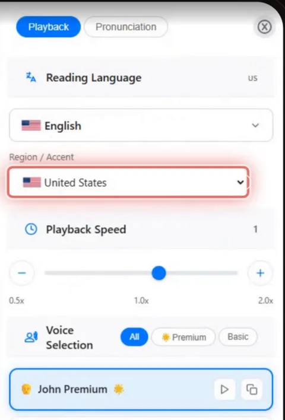

Learning a new language? Use TTSReader to refine your pronunciation, in American or British English.



*On your phone? Watch the [Short](https://youtube.com/shorts/DI2uQutpsg8).*

## Hear it first

I say *tomayto*, you say *tomahto*: American English says tuh-MAY-toh, British English tuh-MAH-toh, and both are correct. On the page it's the same six letters; the difference is only in the sound. To say a word right, you first have to hear it.

Practice on your own, at your speed, as often as you need. Or, in class, project a passage and let TTSReader be the model voice that repeats it as often as your students need.

## How to practice your pronunciation

### 1. Pick the accent you're learning

Open a passage in the [TTSReader web player](https://ttsreader.com/player/), switch the region to **United States** or **United Kingdom**, and choose a voice. The video uses John Premium for American English and wAI Alice for British.

### 2. Slow it down

Slow it down, all the way to half speed (0.5×), with the **−** button under **Playback Speed**.

### 3. Turn on Loop

Turn on **Loop**, and it plays again from the top. Listen, say it back, and compare.

## What a study found

In 2025, a study at a university in Türkiye tested this with TTSReader. Fourteen beginner students listened while it read a passage aloud and highlighted each sentence, then read it back themselves, for four weeks. Their pronunciation improved in all nine sound groups tested: "ng", as in *sing*, went from 43% to 87% correct, and the silent l in *could* from 16% to 69%. All fourteen said it can lower their anxiety about pronunciation. One class of 14, four weeks, no control group: the author reports these limits herself.

## Pick it, slow it, loop it

Pick your accent, slow it down, and loop it.

<a style="color:white;font-weight: bold" href="https://ttsreader.com/player/" target="_blank">👉 &nbsp; TRY TTSREADER NOW</a>

 

New to TTSReader? See the [quick start guide](https://ttsreader.com/docs/guides/quick-start-new-player/). Related read: the [pronunciation dictionary](https://ttsreader.com/blog/ttsreader-pronunciation-dictionary-custom-pronunciation-control-for-text-to-speech/), about the other side of pronunciation: setting how TTSReader itself says a word.


Learning a new language? Use TTSReader to refine pronunciation.

I say tomayto. I say tomahto. Same word, two correct ways to say it. To say a word right, you first have to hear it.

In 2025, a study in Türkiye tested this with TTSReader. Fourteen university students, beginners in English, practiced with it for four weeks.

They listened to a passage while TTSReader read it aloud and highlighted each sentence. Then they read it back themselves, as many times as they needed.

Their pronunciation improved in all nine sound groups tested. The ng sound, as in sing, went from 43 to 87 percent correct. The silent l in could went from 16 to 69 percent. And all fourteen said it can lower their anxiety about pronunciation.

You can practice the same way on your own. Pick the accent you're learning. American, or British. Slow it down, all the way to half speed. Pronunciation. Turn on Loop, and it plays again from the top. Listen, say it back, and compare.

In class, it's a model voice that repeats a passage as often as your students need.

ttsreader.com


*Narration: AI-generated voices from TTSReader: John Premium (American English) and wAI Alice (British English). Study: Önder, F. (2025). The Effectiveness of Online Text-To-Speech Tools in Improving EFL Students' Pronunciation. Journal of Educational Studies and Multidisciplinary Approaches (JESMA), 5(1), 29–47. [https://doi.org/10.51383/jesma.2025.116](https://doi.org/10.51383/jesma.2025.116). Open access under a Creative Commons Attribution (CC BY) license.*
