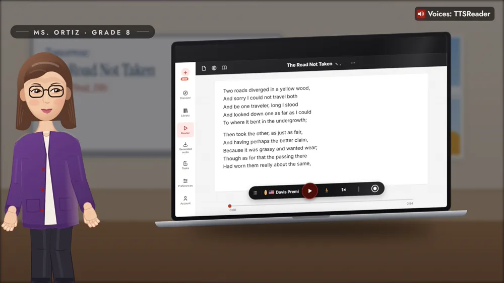
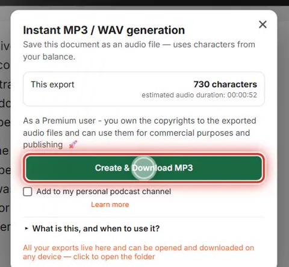
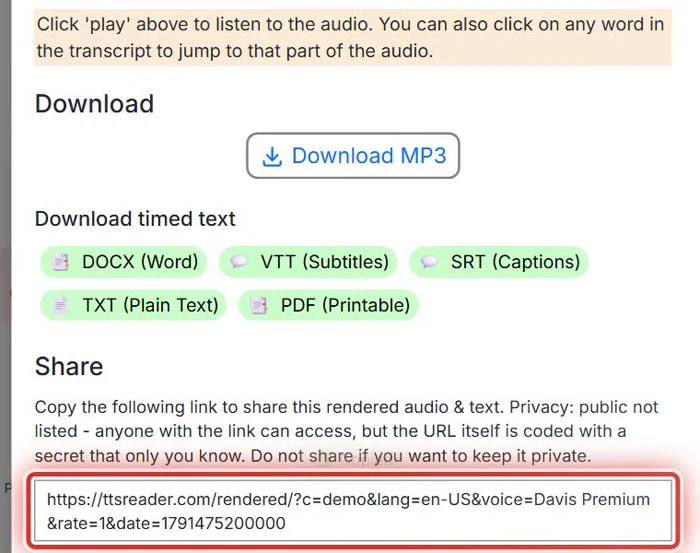
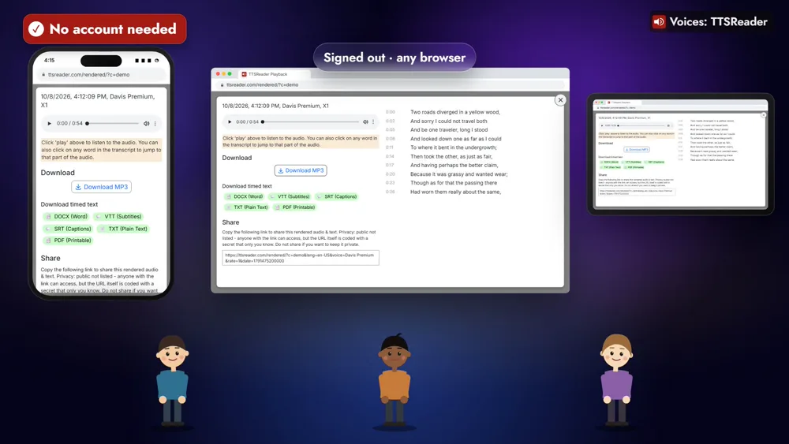
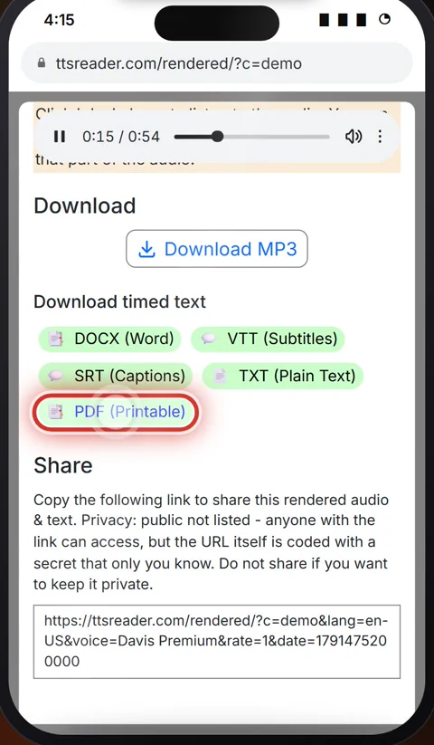
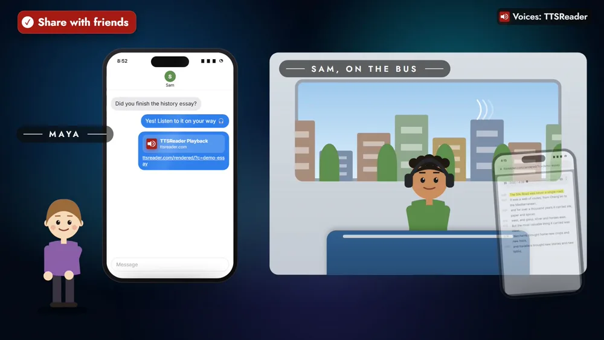

Share what you make with TTSReader: one link for your class, or for your friends.



*On your phone? Watch the [one-minute Short](https://youtube.com/shorts/cwEhOltwtAA).*

## One link for the whole class

Ms. Ortiz turns tomorrow's poem, Robert Frost's "The Road Not Taken", into audio for her class. The file gets its own share link, so she posts it once, and her students open it in any browser, no account needed.

A teacher posts a lesson for the class. A student listens, taps back through the lines, and gets a printable handout. A friend gets your essay in a chat and listens on the bus.

## How to share your audio

### 1. Turn your text into audio

Make an audio file from your text in TTSReader.

### 2. Post the link once

Every file gets its own share link. Copy it from the bottom of its share page and post it once, for everyone.

### 3. Open it in any browser, no account needed

Students open it on whatever they have, a phone, a laptop or a tablet, signed out.

### 4. Tap a line to play it again

The share page plays the audio next to its transcript. Tap any line, and it plays again.

### 5. Download a handout or subtitles

From the same page, download the transcript as a printable PDF for every desk, as a Word or plain-text file, or as SRT and VTT subtitles for the video the class is making.

## With Premium

Each export can also go to your personal podcast channel (see the [guide to creating a podcast](https://ttsreader.com/docs/guides/create-podcasts/) and [how TTSReader lets anyone create a free podcast channel](https://ttsreader.com/blog/ttsreader-lets-anyone-create-a-free-podcast-channel/)). And you own the copyrights to the exported audio, so it's yours to publish, for example on the school website.

## Friends share the same way

Maya sends Sam the link to her history essay, and he listens on the bus.

## Send the link

Turn your text into audio, and send the link.

<a style="color:white;font-weight: bold" href="https://ttsreader.com/player/" target="_blank">👉 &nbsp; OPEN TTSREADER</a>

 

New to TTSReader? Start with the [quick start guide](https://ttsreader.com/docs/guides/quick-start-new-player/). To make the audio itself, see the [voiceover and MP3 export guide](https://ttsreader.com/docs/guides/voiceover/).


Use TTSReader to share what you make, with your class and with your friends.

Ms. Ortiz turns tomorrow's poem into audio for her class. Every file gets its own share link, so she posts it once for everyone. Her students open it in any browser, no account needed.

"Two roads diverged in a yellow wood,"

On the same page, a tap on any line of the transcript plays it again. She downloads the transcript as a PDF, a handout for every desk. And as subtitles, for the video her class is making.

With Premium, each lesson also goes to her own podcast channel, and the audio is hers to publish on the school website.

Friends share the same way: Maya sends Sam her history essay, and he listens on the bus.

Turn your text into audio, and send the link. ttsreader.com


*All speech in the video was produced with TTSReader: Nova Premium (the narrator) and Davis Premium (the poem). "The Road Not Taken" by Robert Frost, from Mountain Interval (1916), is in the public domain in the US. The characters, screens, share links and school website shown are examples made for the video.*
