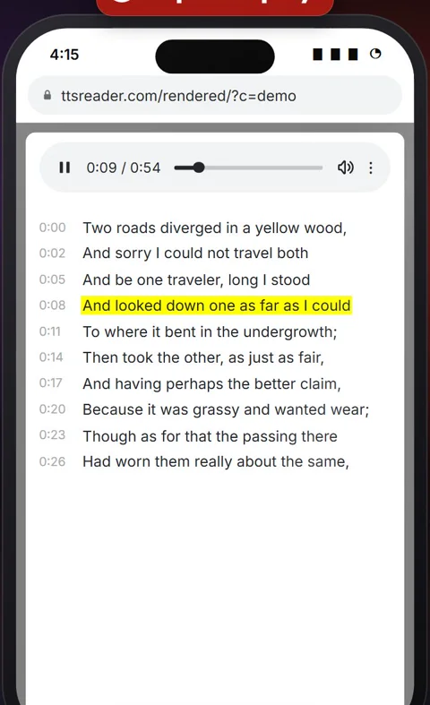
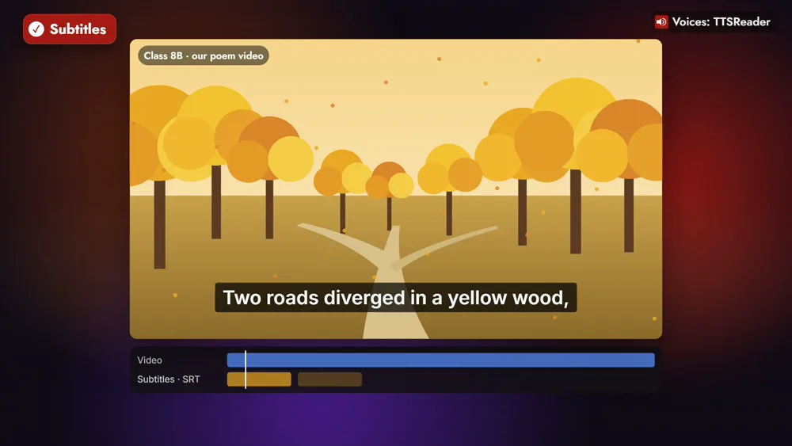

We give every audio file you make in TTSReader its own share link. You post it once, and a whole class, or a friend, can listen in any browser, with no account needed. The page behind that link carries more than the audio: the transcript, a printable handout and subtitles all come from the same place.

<!-- AMIEL: optional, one or two lines of your own here. Delete this comment when done. -->



*On your phone? Watch the [one-minute Short](https://youtube.com/shorts/cwEhOltwtAA).*

Take Ms. Ortiz, who teaches grade 8 English. Tomorrow's poem is Robert Frost's "The Road Not Taken", and tonight she turns it into audio for her class. When the file is ready it has its own share page, and at the bottom of that page is its link. She copies it and posts it once, for the whole class. The link is unlisted: anyone who has it can open it, and the address carries a secret code, so it isn't something people find by searching.

Her students open it on whatever they have, a phone, a laptop or a tablet, signed out. The page plays the poem next to its transcript, and the line being read is highlighted as it goes. A tap on any line of the transcript jumps back to it and plays it again, which is how a student goes over "And looked down one as far as I could" until it sticks.

The same page turns the poem into material for the lesson. Ms. Ortiz downloads the transcript as a printable PDF, a handout for every desk; it also comes as a Word or plain-text file. And it comes as SRT or VTT subtitles, timed to the audio, for the video her class is making about the poem.

With Premium, each export can also go to her personal podcast channel, so the class can follow her readings in a podcast app (the [guide to creating a podcast](https://ttsreader.com/docs/guides/create-podcasts/) shows how, and [how TTSReader lets anyone create a free podcast channel](https://ttsreader.com/blog/ttsreader-lets-anyone-create-a-free-podcast-channel/) tells more). As a Premium user she also owns the copyrights to the exported audio, so the recording is hers to publish on the school website.

Friends share the same way. Maya finishes her history essay, turns it into audio and sends Sam the link in a chat. He opens it on the bus, with headphones, and listens on the way.

Turn your text into audio, then send the link. One link gives your class or your friends the audio and its transcript.

<a style="color:white;font-weight: bold" href="https://ttsreader.com/player/" target="_blank">👉 &nbsp; OPEN TTSREADER</a>

 

New to TTSReader? Start with the [quick start guide](https://ttsreader.com/docs/guides/quick-start-new-player/). To make the audio itself, see the [voiceover and MP3 export guide](https://ttsreader.com/docs/guides/voiceover/).


Use TTSReader to share what you make, with your class and with your friends.

Ms. Ortiz turns tomorrow's poem into audio for her class. Every file gets its own share link, so she posts it once for everyone. Her students open it in any browser, no account needed.

"Two roads diverged in a yellow wood,"

On the same page, a tap on any line of the transcript plays it again. She downloads the transcript as a PDF, a handout for every desk. And as subtitles, for the video her class is making.

With Premium, each lesson also goes to her own podcast channel, and the audio is hers to publish on the school website.

Friends share the same way: Maya sends Sam her history essay, and he listens on the bus.

Turn your text into audio, and send the link. ttsreader.com


*All speech in the video was produced with TTSReader: Nova Premium (the narrator) and Davis Premium (the poem). "The Road Not Taken" by Robert Frost, from Mountain Interval (1916), is in the public domain in the US. The characters, screens, share links and school website shown are examples made for the video.*
