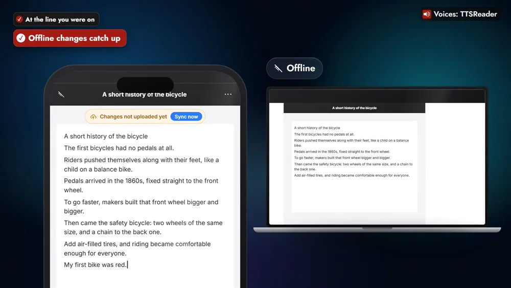

TTSReader keeps your reading in sync across devices: start a document in the web app, and pick it up in the mobile app, on Android or iOS, right where you stopped. Reading rarely happens in one place. It starts at a desk and gets finished on a bus, in a car or on the sofa, and the web app, the phone apps and the car app all share one library.

<!-- AMIEL: optional, one or two lines of your own here. Delete this comment when done. -->



*On your phone? Watch the [one-minute Short](https://youtube.com/shorts/3bHnwU6E6YU).*

Say you open an article at your desk at lunch, a short history of the bicycle, and listen to the first half in the web app. To take it with you, open the document's ⋯ menu, or its row in the Library, and choose **Sync to cloud**. That's done once per document, and you choose which ones.

On the bus home, open TTSReader on your phone, signed in with the same account. The article is in your Library, open at the line you were on, so you press play and it carries on from the safety bicycle, exactly where the web app left it.

The bus goes through a dead zone, and you add a line to the article anyway. The app marks it **Changes not uploaded yet**, and as soon as you're back online the edit goes up to your other devices. When you get in the car, the article is there too, in the TTSReader app on Android Auto or CarPlay.

Books work the same way, chapter by chapter: open *Pride and Prejudice* on your laptop, and your phone opens it at the same chapter. So does your pronunciation dictionary. If a colleague's name keeps coming out wrong, teach it once: add "Siobhan" read as "Shivawn" in the web app, and every app says it right.

> "Siobhan will lead Monday's meeting."

Your Generated Audio Folder comes along as well: the audio you export is ready to open and download on any device. Your voice and speed settings stay with each device, so the phone and the laptop can each read the way that suits them.

Cloud sync is part of TTSReader Premium: sign in, with an active Premium subscription, to sync your documents across devices. Start it here, finish it there.

<a style="color:white;font-weight: bold" href="https://apps.apple.com/us/app/ttsreader-text-to-speech/id6790834349" target="_blank">👉 &nbsp; GET TTSREADER ON THE APP STORE</a>

 

Start in your browser: [open the TTSReader web app](https://ttsreader.com/player/). New to TTSReader? See the [quick start guide](https://ttsreader.com/docs/guides/quick-start-new-player/) and the [first look at TTSReader for iPhone](https://ttsreader.com/blog/ttsreader-for-iphone-a-first-look-at-our-new-mobile-app/).


With TTSReader, work wherever you are, and everything stays in sync. Start a document in the web app, and pick it up in the mobile app, on Android or iOS, right where you stopped. Your place, your books, your pronunciations and your audio files all come along.

Here's how. Sign in with the same account in each app. On a document, choose Sync to cloud. It appears in your other apps, open at the line you were on. Make changes anywhere, even offline, and they go up as soon as you're back online.

Read an article at your desk, then press play on the bus home, and it carries on. In the car, it's there too, in the TTSReader app on Android Auto or CarPlay. Open a book on your laptop, and your phone opens it at the same chapter. Teach it a name once, like Siobhan, and every app says it right.

"Siobhan will lead Monday's meeting."

Start it here, finish it there.


*All speech in the video was produced with TTSReader: Nova Premium (the guide) and John Premium (the app reading the meeting note). Pride and Prejudice by Jane Austen, from Project Gutenberg, is in the public domain. Android and Android Auto are trademarks of Google LLC; iOS is a trademark or registered trademark of Cisco in the U.S. and other countries, used under license by Apple; CarPlay is a trademark of Apple Inc.*
