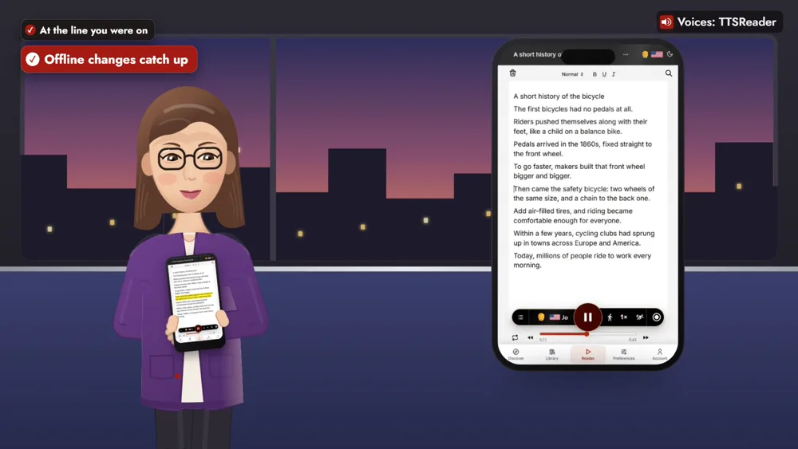
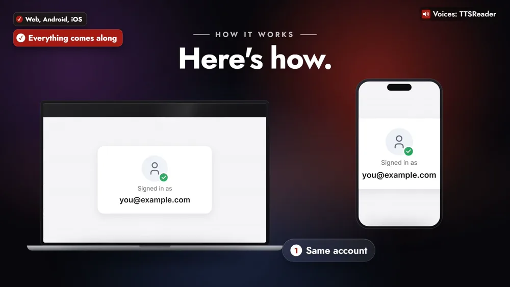
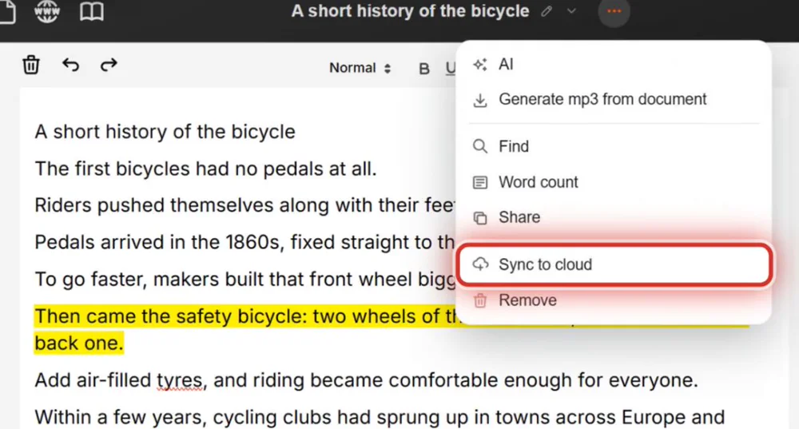
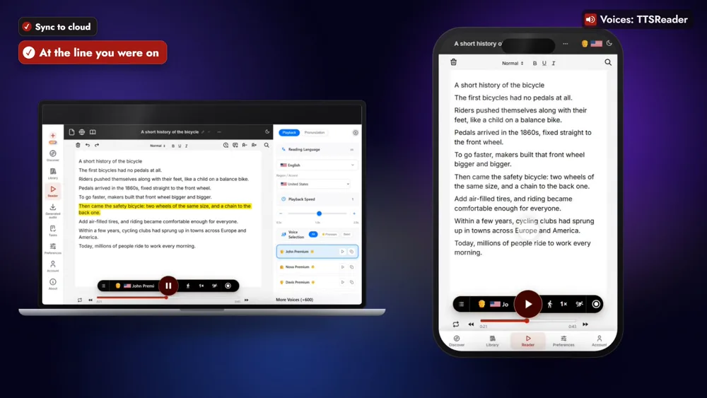
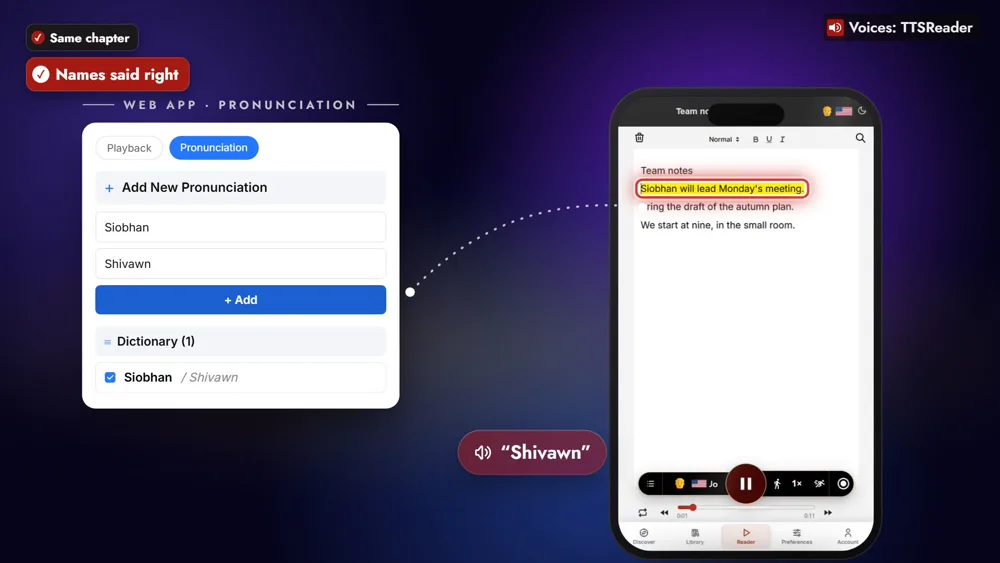

Start a document in the TTSReader web app, and pick it up in the mobile app, on Android or iOS, right where you stopped.



*On your phone? Watch the [one-minute Short](https://youtube.com/shorts/3bHnwU6E6YU).*

## Read at your desk, listen on the bus

Say you start an article at your desk at lunch, a short history of the bicycle. On the bus home, you press play on your phone, and it carries on from the line where you stopped.

It's there in the car too, in the TTSReader app on Android Auto or CarPlay.

## How to sync TTSReader across devices

### 1. Sign in with the same account in each app

### 2. On a document, choose Sync to cloud

Open the document's ⋯ menu, or its row in the Library, and choose **Sync to cloud**.

### 3. Open it in your other apps

It appears in your Library on the other device, open at the line you were on.

### 4. Make changes anywhere, even offline

Edits made offline go up as soon as you're back online.

## Books, names and audio come along

Open a book on your laptop, and your phone opens it at the same chapter. Teach it a name once, like "Siobhan" read as "Shivawn", and every app says it right. Your Generated Audio Folder comes along too.

## Start it here, finish it there

Cloud sync is part of TTSReader Premium: sign in, with an active Premium subscription, to sync your documents across devices.

<a style="color:white;font-weight: bold" href="https://apps.apple.com/us/app/ttsreader-text-to-speech/id6790834349" target="_blank">👉 &nbsp; GET TTSREADER ON THE APP STORE</a>

 

Start in your browser: [open the TTSReader web app](https://ttsreader.com/player/). New to TTSReader? See the [quick start guide](https://ttsreader.com/docs/guides/quick-start-new-player/) and the [first look at TTSReader for iPhone](https://ttsreader.com/blog/ttsreader-for-iphone-a-first-look-at-our-new-mobile-app/).


With TTSReader, work wherever you are, and everything stays in sync. Start a document in the web app, and pick it up in the mobile app, on Android or iOS, right where you stopped. Your place, your books, your pronunciations and your audio files all come along.

Here's how. Sign in with the same account in each app. On a document, choose Sync to cloud. It appears in your other apps, open at the line you were on. Make changes anywhere, even offline, and they go up as soon as you're back online.

Read an article at your desk, then press play on the bus home, and it carries on. In the car, it's there too, in the TTSReader app on Android Auto or CarPlay. Open a book on your laptop, and your phone opens it at the same chapter. Teach it a name once, like Siobhan, and every app says it right.

"Siobhan will lead Monday's meeting."

Start it here, finish it there.


*All speech in the video was produced with TTSReader: Nova Premium (the guide) and John Premium (the app reading the meeting note). Pride and Prejudice by Jane Austen, from Project Gutenberg, is in the public domain. Android and Android Auto are trademarks of Google LLC; iOS is a trademark or registered trademark of Cisco in the U.S. and other countries, used under license by Apple; CarPlay is a trademark of Apple Inc.*
