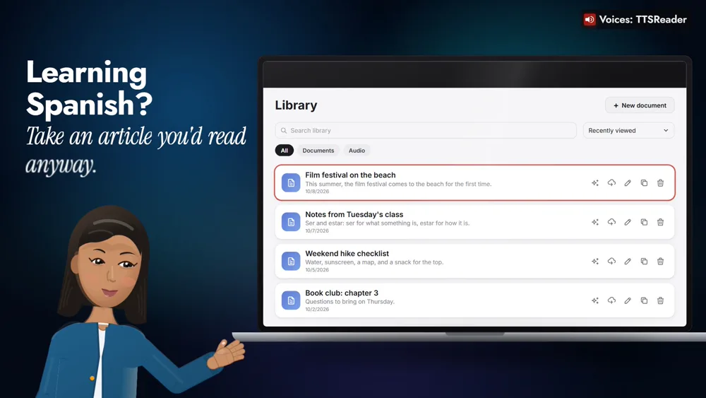
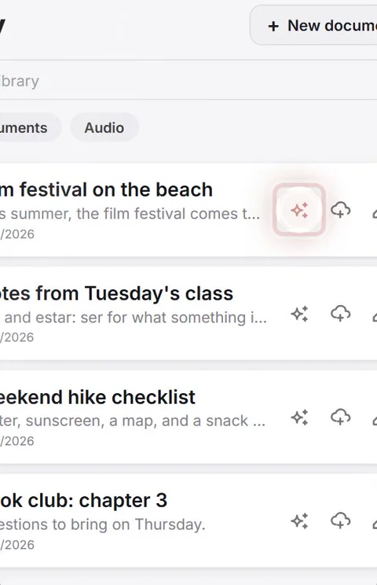
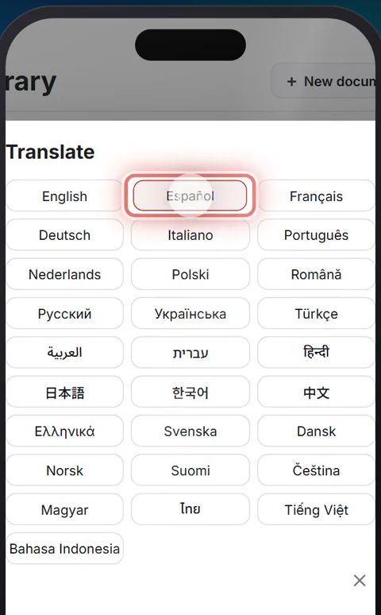
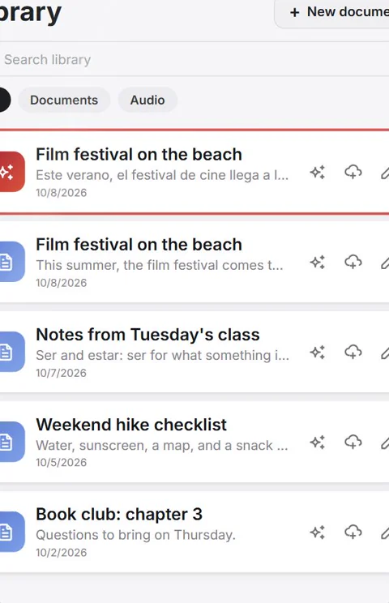
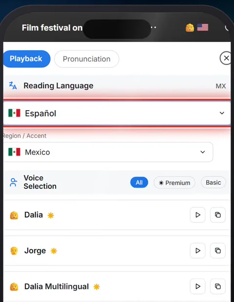
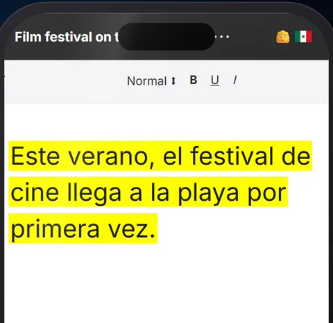
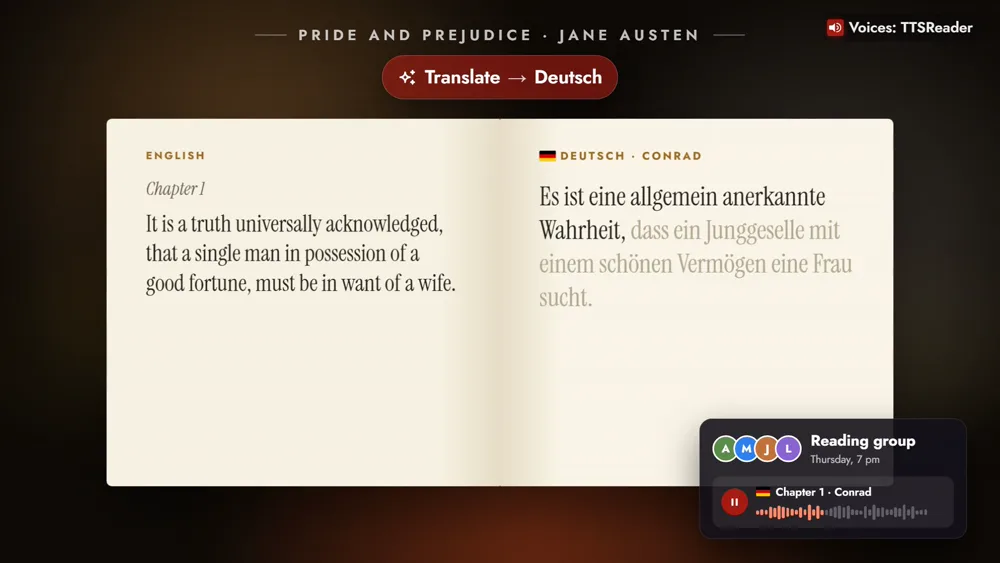

TTSReader translates your text into 28 languages and reads it aloud, so you can listen in the language you need.



*On your phone? Watch the [Short](https://youtube.com/shorts/gHraQgf2ulA).*

## Listen in the language you need

Learning Spanish? Take an article you'd read anyway, like this summer's piece about a film festival on the beach, and have a Spanish voice read it to you.

Or translate the day's news into French for a friend in Paris, a book chapter into German for your reading group, or a podcast script into Japanese.

## How to translate and listen

### 1. Click the AI button on the article

With Premium, open your library and click **AI** on the article.

### 2. Choose Translate, and pick a language

Choose **Translate**, and pick **Español**, one of 28 languages.

### 3. Open the Spanish copy

A Spanish copy of the article appears in your library, ready to open.

### 4. Tap the voice and choose a Spanish voice

Open it, tap the voice, and choose a Spanish voice. Here it's Dalia, from Mexico.

### 5. Press play

"Este verano, el festival de cine llega a la playa por primera vez."

## Keep it, or bring your own

To keep it, choose **Generate mp3 from document** and listen on the go. Already in another language? Paste it in, and pick a voice in that language.

## A voice for every language

Denise reads the French news, Conrad the German *Pride and Prejudice*, Keita the Japanese script.

## Pick a language, and press play

Translate is part of TTSReader Premium.

<a style="color:white;font-weight: bold" href="https://ttsreader.com/player/" target="_blank">👉 &nbsp; OPEN TTSREADER</a>

 

New to TTSReader? Start with the [quick start guide](https://ttsreader.com/docs/guides/quick-start-new-player/). Mixing languages and voices in one document? See [creating multi-voice, multi-language audio in TTSReader](https://ttsreader.com/blog/creating-multi-voice-multi-languages-in-ttsreader/).


TTSReader translates your text into 28 languages, and reads it aloud, so you can listen in the language you need.

Learning Spanish? Take an article you'd read anyway. With Premium, open your library and click the AI button on the article. Choose Translate, and pick a language: Spanish. A Spanish copy of the article appears in your library, ready to open. Open it, tap the voice, and choose a Spanish voice. Then press play.

"Este verano, el festival de cine llega a la playa por primera vez."

To keep it, choose Generate mp3 from document, and listen on the go. Already have it in another language? Paste it in, and pick a voice in that language.

Or the day's news, into French, for a friend in Paris. "Ce matin, la bibliothèque du quartier rouvre ses portes, avec un jardin de lecture."

Or a chapter of a book into German, for your reading group. "Es ist eine allgemein anerkannte Wahrheit, dass ein Junggeselle mit einem schönen Vermögen eine Frau sucht."

And a podcast script into Japanese, for an episode in a new language. 「皆さん、こんにちは。今日のエピソードへようこそ。」

Pick a language, and press play.


*All speech in the video was produced with TTSReader: Nova Premium (the guide), Dalia (es-MX), Denise (fr-FR), Conrad (de-DE) and Keita (ja-JP), Microsoft Azure neural voices served through TTSReader. Pride and Prejudice by Jane Austen (1813) is in the public domain; the other example sentences were written for the video.*
