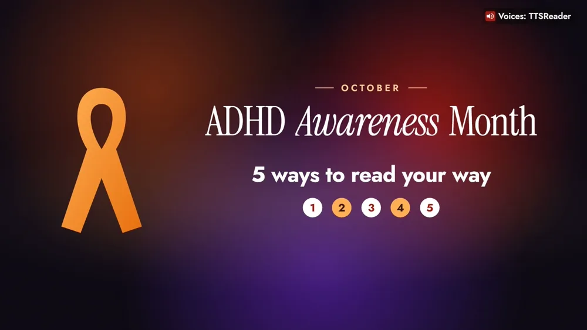
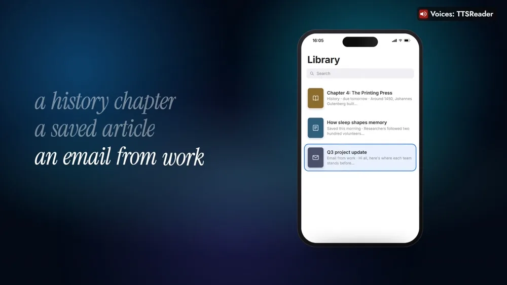
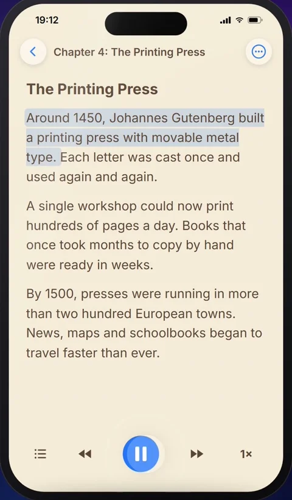
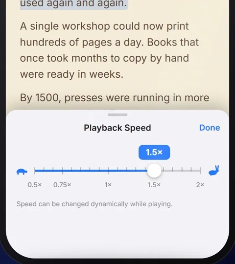
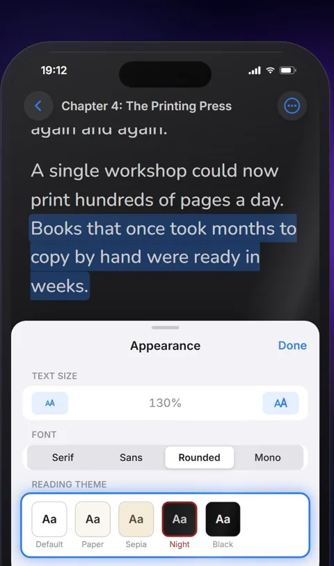
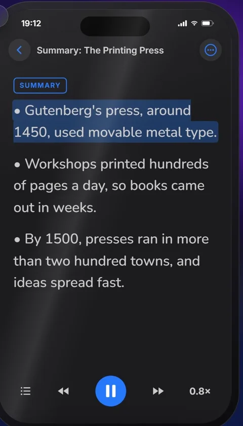

TTSReader reads your text aloud and highlights each sentence, so your eyes and ears move together.



*On your phone? Watch the [one-minute Short](https://youtube.com/shorts/fcxc1cHJTmk).*

## October is ADHD Awareness Month

Here are five ways to make reading fit the way you focus, all of them settings in the TTSReader app.

Take a history chapter for tomorrow, an article you saved this morning, or a long email from work. They all open in your TTSReader library, ready to be read aloud.

## Five ways to read your way, step by step

Here's the history chapter, on your phone.

### 1. Press play and follow the highlight

TTSReader reads the chapter aloud and highlights the sentence it is reading, one sentence at a time, so you can follow along on the page.

### 2. Set your speed

Tap the speed button and slide: a little faster to keep your momentum, slower for the tricky parts. Playback Speed goes from 0.5× to 2×, and you can change it while it plays.

### 3. Make the page yours

In **Appearance**, make the text bigger, pick a font (Serif, Sans, **Rounded** or Mono) and a reading theme (Default, Paper, Sepia, **Night** or Black). The page changes as you tap.

### 4. Hear the main points first

In the ⋯ menu, tap **AI › Summarize**. TTSReader writes a short summary as a new document and reads it to you; then go back to the whole chapter. Summarize is a Premium feature.

### 5. Keep moving

Lock the screen and keep listening while you walk, stretch, or fold the laundry. TTSReader keeps playing, with the controls on the lock screen.

## Read it your way

The highlight, your speed, your page, the main points first, and listening on the move: read it your way, with TTSReader.

<a style="color:white;font-weight: bold" href="https://apps.apple.com/us/app/ttsreader-text-to-speech/id6790834349" target="_blank">👉 &nbsp; GET TTSREADER ON THE APP STORE</a>

 

Prefer your computer? [Open TTSReader in your browser](https://ttsreader.com/player/). New to the app? See the [quick start guide](https://ttsreader.com/docs/guides/quick-start-new-player/) and the [first look at TTSReader for iPhone](https://ttsreader.com/blog/ttsreader-for-iphone-a-first-look-at-our-new-mobile-app/).

*TTSReader is a reading tool, not a treatment for ADHD.*


TTSReader reads your text aloud and highlights each sentence, so your eyes and ears move together. October is ADHD Awareness Month. Here are five ways to make reading fit the way you focus.

Take a history chapter for tomorrow, an article you saved this morning, or a long email from work. Here's the history chapter, on your phone.

One: press play and follow the highlight, one sentence at a time. Two: set your speed. A little faster to keep your momentum, slower for the tricky parts. Three: make the page yours, with bigger text, a rounded font and a calm night theme. Four: tap Summarize to hear the main points first, then go back to the whole chapter. Five: lock the screen and keep listening while you walk, stretch, or fold the laundry.

Read it your way, with TTSReader. ttsreader.com


*All speech in the video was produced with TTSReader: Nova Premium (the guide). The history chapter, the article and the email on screen were written for the video.*
