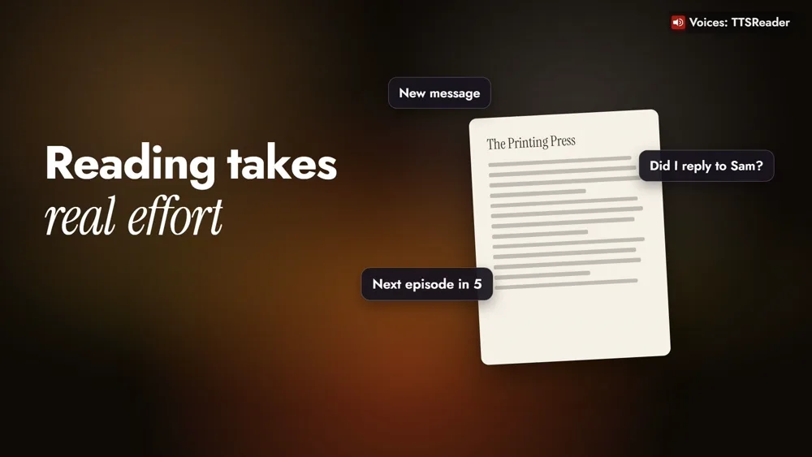
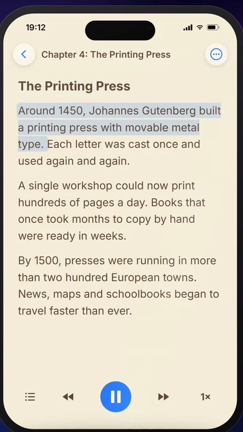
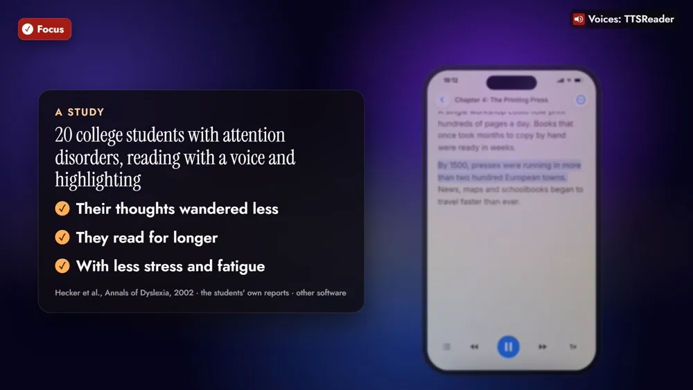
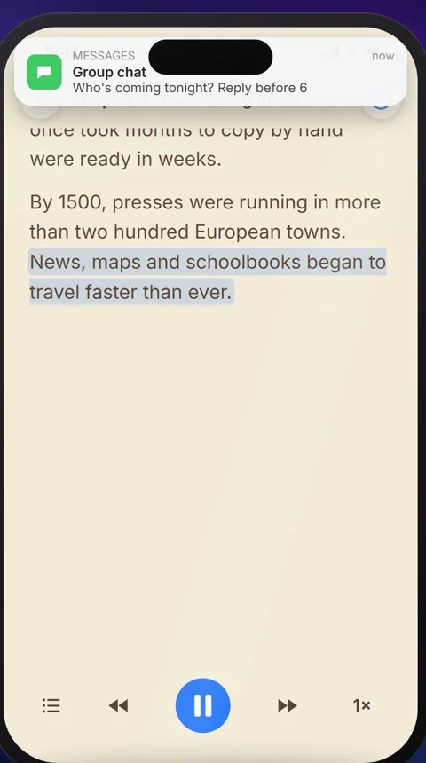
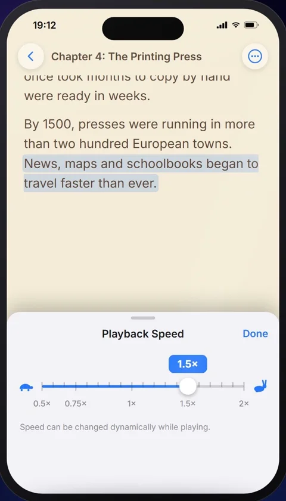
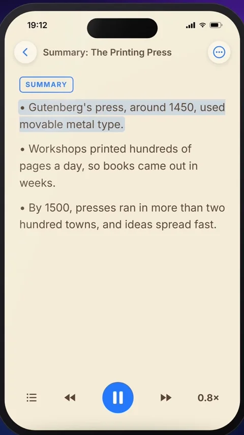
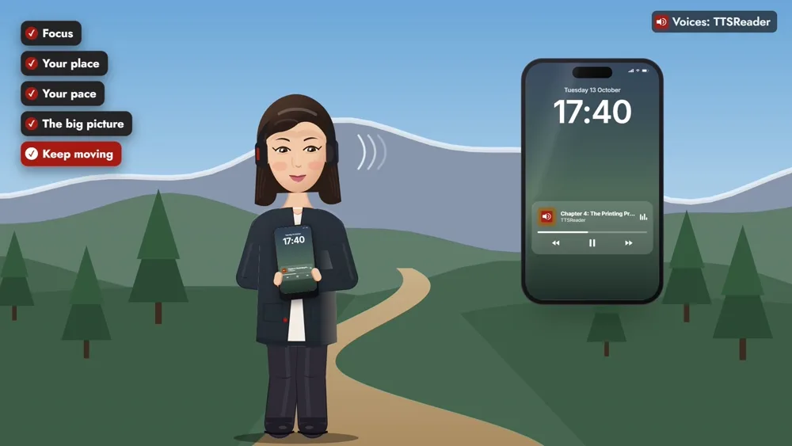
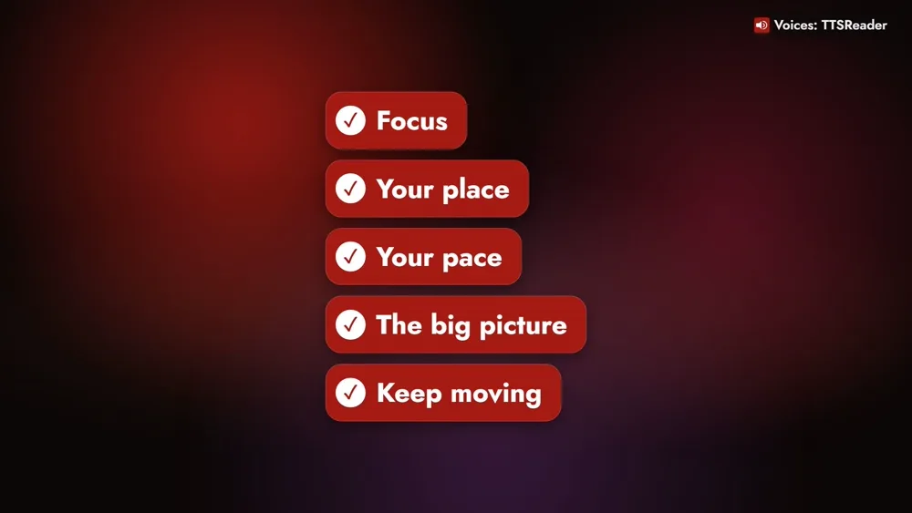

October is ADHD Awareness Month, so let's look at how TTSReader can make reading easier for people with ADHD.



*On your phone? Watch the [Short](https://youtube.com/shorts/nIJeNLYCYqs).*

## Reading takes real effort

For many people with ADHD, reading takes real effort. Getting focused is hard, and every distraction pulls you off the page: a new message, a thought about something else, the next episode waiting.

TTSReader has a few features that help with exactly that. Here they are on a history chapter that's due tomorrow.

## How TTSReader helps, step by step

### 1. Focus: a voice and a highlight on the same line

Press play. TTSReader reads the text aloud and highlights each sentence as it's spoken. Your eyes and your ears follow the same line, so there's one thing to focus on.

### What a study found

In a study of twenty college students with attention disorders, reading with a voice and highlighting, the students said their thoughts wandered less. They read for longer, with less stress and fatigue.

The study is Hecker, Burns, Elkind, Elkind and Katz (2002), *Benefits of assistive reading software for students with attention disorders*, Annals of Dyslexia 52. It compared each student's reading with and without software that speaks the text with synchronized highlighting. That software wasn't TTSReader, the findings above are partly the students' own reports, and the study found no significant effect on comprehension.

### 2. Your place: the highlight marks where you left off

When something does pull you away, the highlight is still there, marking exactly where you left off. Look back and carry on from that sentence.

### 3. Your pace: faster in the flow, slower when it's dense

Tap the speed button and set the pace: speed it up while you're in the flow, and slow it down when a paragraph gets dense. Playback Speed goes from 0.5× to 2×, and you can change it while it plays.

### 4. The big picture: the main points first

If a long chapter feels hard to start, open the ⋯ menu and tap **AI › Summarize**. You hear the main points first, so you know where the chapter is going before you dive in. Summarize is a Premium feature.

### 5. Keep moving: lock the screen and walk

If you think better on the move, lock the screen. TTSReader keeps reading while you walk, with the controls on the lock screen.

## Reading that works the way your mind does

So: a voice and a highlight to keep you focused, a marker that keeps your place, your own pace, the big picture first, and the freedom to move.

<a style="color:white;font-weight: bold" href="https://apps.apple.com/us/app/ttsreader-text-to-speech/id6790834349" target="_blank">👉 &nbsp; GET TTSREADER ON THE APP STORE</a>

 

Prefer your computer? [Open TTSReader in your browser](https://ttsreader.com/player/). New to the app? See the [quick start guide](https://ttsreader.com/docs/guides/quick-start-new-player/) and the [first look at TTSReader for iPhone](https://ttsreader.com/blog/ttsreader-for-iphone-a-first-look-at-our-new-mobile-app/).

*TTSReader is a reading tool, not a treatment for ADHD.*


October is ADHD Awareness Month, so let's look at how TTSReader can make reading easier for people with ADHD.

For many people with ADHD, reading takes real effort. Getting focused is hard, and every distraction pulls you off the page.

TTSReader has a few features that help with exactly that. Let's see them on a history chapter that's due tomorrow.

First, TTSReader reads the text aloud and highlights each sentence as it's spoken. Your eyes and your ears follow the same line, so there's one thing to focus on. In a study of twenty college students with attention disorders, reading with a voice and highlighting, the students said their thoughts wandered less. They read for longer, with less stress and fatigue.

And when something does pull you away, the highlight is still there, marking exactly where you left off. You also set the pace. Speed it up while you're in the flow, and slow it down when a paragraph gets dense.

If a long chapter feels hard to start, tap Summarize. You hear the main points first, so you know where the chapter is going before you dive in. And if you think better on the move, lock the screen. TTSReader keeps reading while you walk.

So: a voice and a highlight to keep you focused, a marker that keeps your place, your own pace, the big picture first, and the freedom to move.

TTSReader. Reading that works the way your mind does. ttsreader.com


*All speech in the video was produced with TTSReader: Nova Premium (the guide). The history chapter, the summary and the distractions on screen were written for the video. Study: Hecker, L., Burns, L., Elkind, J., Elkind, K., & Katz, L. (2002). Benefits of assistive reading software for students with attention disorders. Annals of Dyslexia, 52, 243.*
