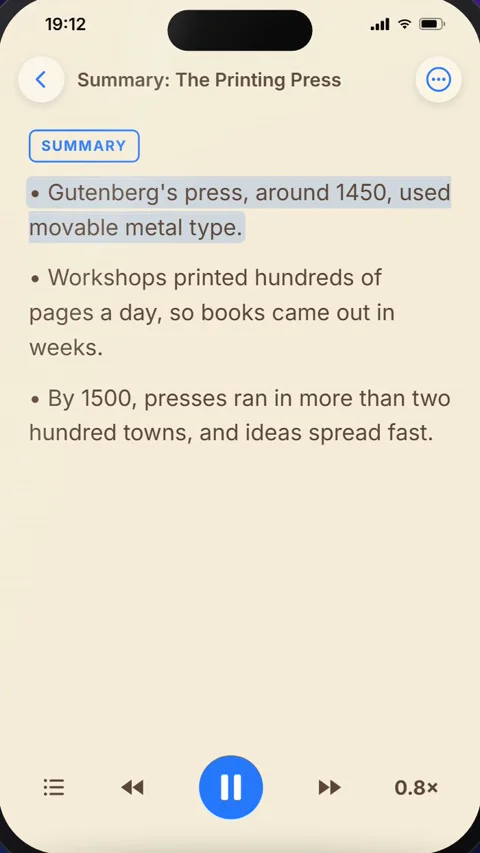

For ADHD Awareness Month: how TTSReader can make reading easier for people with ADHD.



*On your phone? Watch the [Short](https://youtube.com/shorts/nIJeNLYCYqs).*

## Why reading takes effort

For many people with ADHD, reading takes real effort. Getting focused is hard, and every distraction pulls you off the page. Picture a history chapter on the printing press, due tomorrow: you sit down to read it, and a new message arrives, then a sudden "did I reply to Sam?", then the next episode starting in five minutes.

The same thing happens with a chapter for class, an article you saved to read later, or a long document at work. TTSReader reads the text aloud with you, and five of its features help with exactly that.

## How to use TTSReader when focus is hard

### 1. Press play and follow the highlight

TTSReader reads the text aloud and highlights each sentence as it's spoken. Your eyes and your ears follow the same line, so there's one thing to focus on.

### 2. Let the highlight keep your place

When something does pull you away, the highlight is still there, marking exactly where you left off. You carry on from that sentence instead of hunting for it.

### 3. Set your own pace

Tap the speed button. Speed it up while you're in the flow, and slow it down when a paragraph gets dense. Playback Speed goes from 0.5× to 2×, and you can change it while it plays.

### 4. Hear the big picture first

If a long chapter feels hard to start, open the ⋯ menu and tap **AI › Summarize**. It writes a short summary as a new document, so you hear the main points first and know where the chapter is going before you dive in. Summarize is a Premium feature.

### 5. Keep moving

If you think better on the move, lock the screen. TTSReader keeps reading while you walk, with the controls on the lock screen.

## What a study found

In a study of twenty college students with attention disorders, reading with a voice and highlighting, the students said their thoughts wandered less. They read for longer, with less stress and fatigue. The study (Hecker et al., 2002, *Annals of Dyslexia*) used other software, not TTSReader, its findings are partly the students' own reports, and it found no significant effect on comprehension.

## Read it your way

A voice and a highlight to keep you focused, a marker that keeps your place, your own pace, the big picture first, and the freedom to move: reading that works the way your mind does.

<a style="color:white;font-weight: bold" href="https://apps.apple.com/us/app/ttsreader-text-to-speech/id6790834349" target="_blank">👉 &nbsp; GET TTSREADER ON THE APP STORE</a>

 

Prefer your computer? [Open TTSReader in your browser](https://ttsreader.com/player/). New to the app? See the [quick start guide](https://ttsreader.com/docs/guides/quick-start-new-player/) and the [first look at TTSReader for iPhone](https://ttsreader.com/blog/ttsreader-for-iphone-a-first-look-at-our-new-mobile-app/).

*TTSReader is a reading tool, not a treatment for ADHD.*


October is ADHD Awareness Month, so let's look at how TTSReader can make reading easier for people with ADHD.

For many people with ADHD, reading takes real effort. Getting focused is hard, and every distraction pulls you off the page.

TTSReader has a few features that help with exactly that. Let's see them on a history chapter that's due tomorrow.

First, TTSReader reads the text aloud and highlights each sentence as it's spoken. Your eyes and your ears follow the same line, so there's one thing to focus on. In a study of twenty college students with attention disorders, reading with a voice and highlighting, the students said their thoughts wandered less. They read for longer, with less stress and fatigue.

And when something does pull you away, the highlight is still there, marking exactly where you left off. You also set the pace. Speed it up while you're in the flow, and slow it down when a paragraph gets dense.

If a long chapter feels hard to start, tap Summarize. You hear the main points first, so you know where the chapter is going before you dive in. And if you think better on the move, lock the screen. TTSReader keeps reading while you walk.

So: a voice and a highlight to keep you focused, a marker that keeps your place, your own pace, the big picture first, and the freedom to move.

TTSReader. Reading that works the way your mind does. ttsreader.com


*All speech in the video was produced with TTSReader: Nova Premium (the guide). The history chapter, the summary and the distractions on screen were written for the video. Study: Hecker, L., Burns, L., Elkind, J., Elkind, K., & Katz, L. (2002). Benefits of assistive reading software for students with attention disorders. Annals of Dyslexia, 52, 243.*
