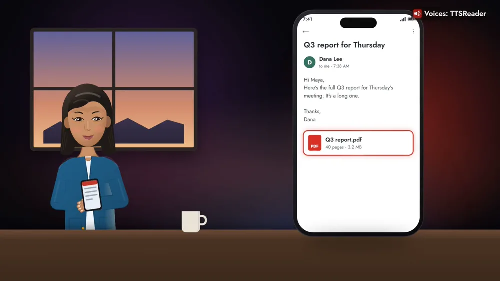
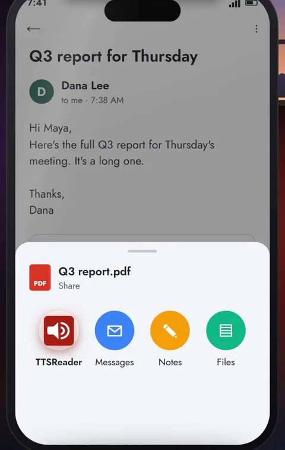
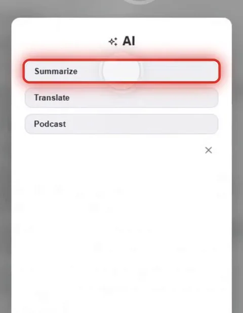
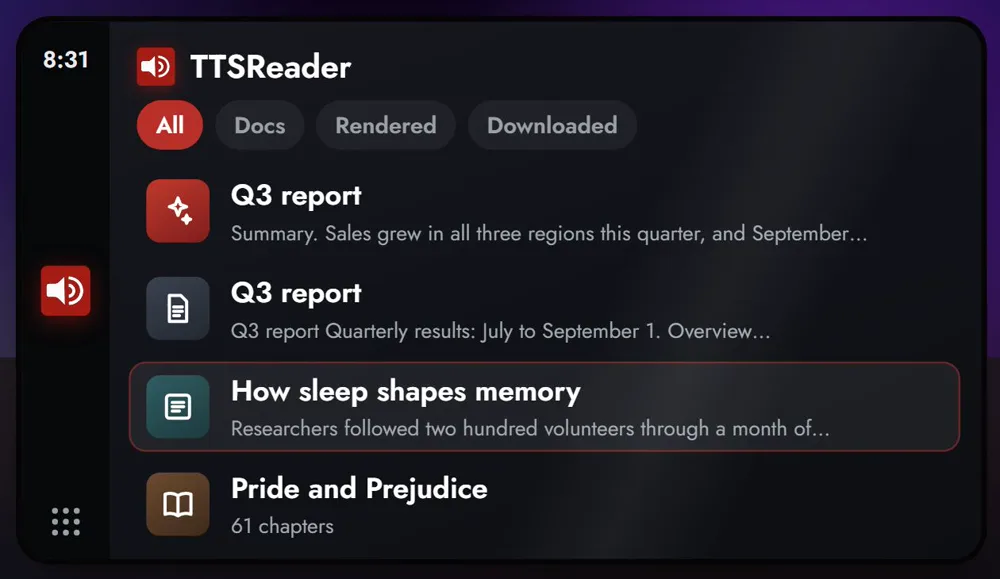
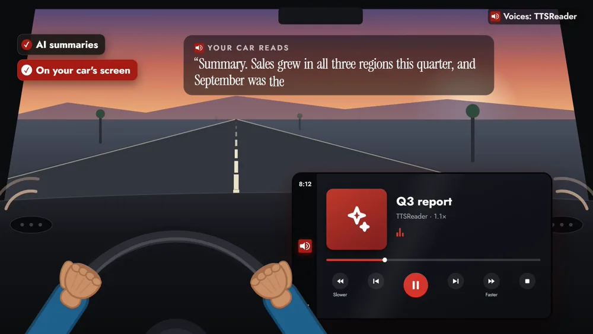
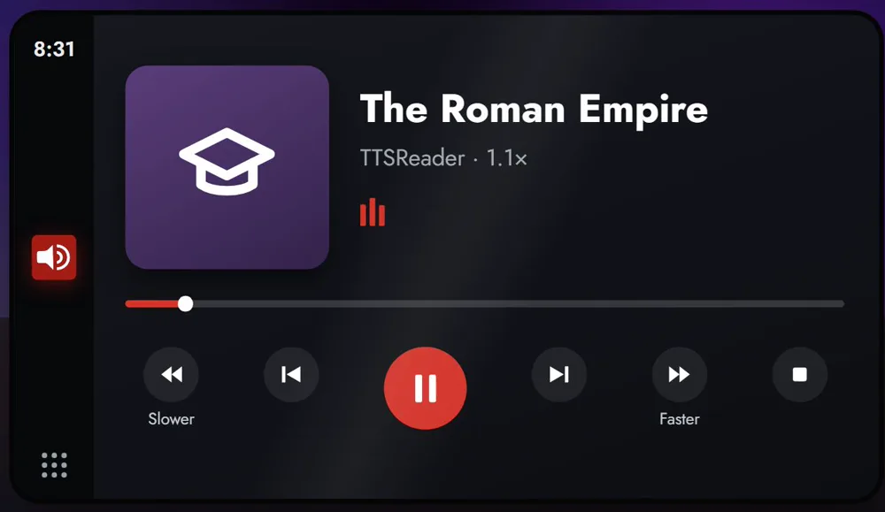

Turn your drive into reading time: TTSReader reads your reports, articles and books aloud in the car, on Android Auto or CarPlay.



*On your phone? Watch the [Short](https://youtube.com/shorts/2MOIzFDIuTw).*

## A forty-page report and a drive in

Maya has a forty-page report to read before her meeting.

It doesn't have to be work: articles, books, today's news recap, or a lesson on something new.

## How to listen in the car

### 1. Share it to TTSReader

Before you leave, share it to TTSReader on your phone: on Android, a PDF, Word file, EPUB, text or web link.

### 2. Tap Summarize

Tap **Summarize**, and TTSReader writes a short version made for listening.

### 3. Connect your phone in the car

TTSReader is right there on Android Auto or CarPlay, with the summary at the top of your library.

### 4. Press play, and keep your eyes on the road

One tap while parked, and it plays through the car's speakers. Play, pause, skip, **Slower** and **Faster** are one tap away. Set it up before you drive or while parked.

> "Summary. Sales grew in all three regions this quarter, and September was the strongest month."

## News, lessons and offline listening

Ask for today's news recap or a lesson on any topic, written for listening, from 5 to 60 minutes long. Downloaded audio plays from the Downloaded tab even without a signal.

## Make every drive count

Summarize, News Recap, Learn a topic and audio downloads are Premium features. Get the app, share the next long thing you meant to read, and make every drive count.

<a style="color:white;font-weight: bold" href="https://apps.apple.com/us/app/ttsreader-text-to-speech/id6790834349" target="_blank">👉 &nbsp; GET TTSREADER ON THE APP STORE</a>

 

Prefer your computer? [Open TTSReader in your browser](https://ttsreader.com/player/). New to the app? See the [quick start guide](https://ttsreader.com/docs/guides/quick-start-new-player/) and the [first look at TTSReader for iPhone](https://ttsreader.com/blog/ttsreader-for-iphone-a-first-look-at-our-new-mobile-app/). Looking for something to listen to on the road? [All of Project Gutenberg and LibriVox are in TTSReader](https://ttsreader.com/blog/ttsreader-now-holds-all-of-project-gutenberg-and-all-of-librivox-with-5000-hours-of-human-narration-synced-to-the-text/), with CarPlay and Android Auto.


Turn your drive into reading time. Maya has a forty-page report to read before her meeting. She shares it to TTSReader and taps Summarize. In the car, she connects her phone, and TTSReader is right there on Android Auto or CarPlay.

"Summary. Sales grew in all three regions this quarter, and September was the strongest month."

Her eyes stay on the road, and her reading plays through the car's speakers. And it doesn't have to be work: articles, books, today's news recap, or a lesson on something new. Downloaded something? Keep listening even without a connection.

Make every drive count. ttsreader.com


*All speech in the video was produced with TTSReader: Nova Premium (the narrator) and Davis Premium (the car reading the summary). Maya and her report are fictional. Android Auto is a trademark of Google LLC. CarPlay is a trademark of Apple Inc.*
