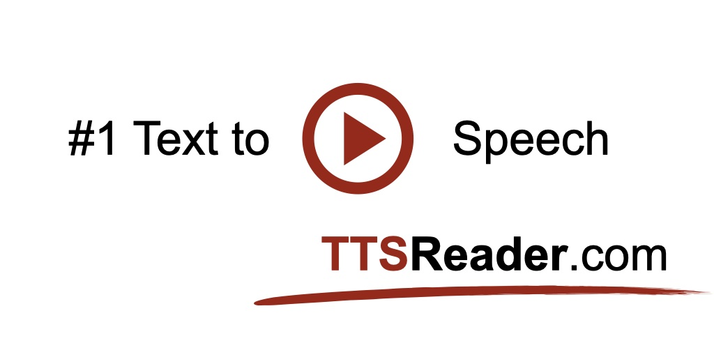

*By Amiel | Jan 8, 2026*

The perceived quality of any text-to-speech (TTS) application is largely determined by its underlying synthesis engine and the diversity of its voice library. TTSReader integrates Microsoft Azure's neural TTS platform, providing users with access to a library of over 600 high-quality, natural-sounding voices.

This guide provides a brief technical overview of the technology and practical guidance on selecting the appropriate voice for your project.

## The Technology: Neural Text-to-Speech

Modern TTS has moved beyond the robotic-sounding concatenative or parametric systems of the past. Our voices are powered by neural TTS, a synthesis model that uses deep neural networks to generate speech.

*   **How it works:** Instead of stitching together pre-recorded phonetic units, neural models predict acoustic features (like a spectrogram) from input text. These features are then converted into audio using a vocoder.
*   **The result:** This approach produces speech with significantly more natural prosody, intonation, and emotional range. The model learns the stress patterns and reflections in tone that are characteristic of human speech, resulting in a more fluid and engaging listening experience.

By leveraging Azure's robust and mature neural TTS platform, we can offer a vast, consistently updated, and highly reliable voice library.

## Selecting the Right Voice: Use Cases

With over 600 voices across dozens of languages and dialects, choosing the right one is key to a successful project. Here are some common use cases and voice selection strategies.

### Use Case 1: Long-Form Narration (Audiobooks, Articles)
For content that requires sustained listening, clarity and a neutral, pleasant tone are paramount.
*   **Objective:** Minimize listening fatigue and ensure high comprehension.
*   **Recommended Voices:** Standard, high-quality voices like `en-US-AriaNeural` or `en-GB-LibbyNeural` are excellent choices. They are clear, well-paced, and have a professional, narrative quality.

### Use Case 2: Customer-Facing Applications (IVR, Support Bots)
In this context, a friendly and helpful tone is crucial for a positive user experience.
*   **Objective:** Convey helpfulness and build user trust.
*   **Recommended Voices:** Voices designed for interaction, such as `en-US-JennyNeural`, often have a more upbeat and engaging intonation suitable for customer service roles.

### Use Case 3: Character Dialogue (Storytelling, Gaming, Dialogues)
For creative projects, a diverse cast of voices is essential.
*   **Objective:** Create distinct characters and convey emotion.
*   **Strategy:** Experiment with voices that have different pitches, speeds, and emotional styles. You can use our `{{set:...}}` command (covered in a future post) to switch between these voices dynamically within a single text to create dialogues.

### Use Case 4: Global Content (Localization)
To reach a global audience, content must be localized.
*   **Objective:** Provide native-sounding audio for different regions.
*   **Strategy:** Our library includes numerous voices for dozens of languages and regional dialects (e.g., `es-MX` for Mexican Spanish, `fr-CA` for Canadian French). Using the correct regional voice is critical for authenticity.

The extensive voice library is a core component of the TTSReader platform, providing the flexibility to tackle nearly any speech synthesis task.

**[Explore the Voices in the Player](https://ttsreader.com/player/)**

